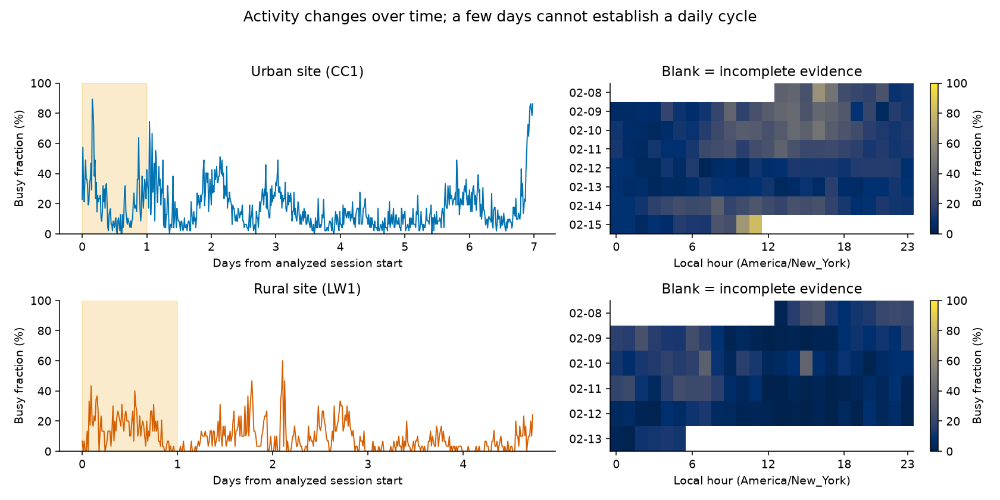

# Spectrum Occupancy Forecasting

**Explore radio measurements, understand their patterns, and test how well recent activity predicts the future.**

[](https://github.com/awiecz/spectrum-occupancy-forecasting/actions/workflows/ci.yml)

## The question

How useful are recent radio measurements for predicting future activity—and what happens when
those measurements are missing or out of date? This completed exploratory investigation
combines data-quality checks, visual analysis and comparisons of simple averages with trained models.

The main forecast predicts the busy fraction of a **15-minute period starting 15 minutes ahead**.
A forecast made at noon therefore concerns **12:15–12:30**.

## What was measured?

Public [AERPAW recordings](https://doi.org/10.5061/dryad.hmgqnk9zn) contain repeated sweeps:
snapshots of received radio power across frequencies. We analyze a band centered at
2437 MHz, associated with Wi-Fi channel 6, at an **urban site (CC1)** and a **rural site (LW1)**.
Their first continuous recordings cover seven and 4.75 days in February 2022.


A 30% busy fraction means 30% of sampled measurements exceeded the threshold.
It does **not** directly measure decoded traffic, transmitter duty cycle or channel capacity.
The first day establishes each site's threshold; later measurements use that fixed definition.

## What does the data show?

- **Activity persists, with occasional larger changes.** Nearby periods often resemble each other, making recent history useful.
- **The analyzed sessions have good coverage.** All complete 15-minute windows pass the observation-count filter; incomplete final windows are excluded.
- **The definition of busy matters.** At the rural site, changing the threshold from +2 to +4 dB reduces detected activity from 30.15% to 0.70% of later snapshots.



*Received-power labels vary over time. Shading marks calibration; blank heatmap cells indicate
incomplete evidence. These few days do not establish a stable daily cycle.*

The [data study](docs/data_study.md) explains the measurements, recording gaps, labeling,
patterns and sensitivity through six figure groups and reproducible statistics.

## What did forecasting establish?

**Simple history is a strong baseline.** Trained models did not establish a reliable advantage.
Missing and delayed inputs reduce useful evidence; these disruptions are simulated.

A [study of local adaptation](docs/adaptive_learning.md) tests whether completed measurements
can improve later forecasts. It tested 145 settings for correcting bias, combining history
forecasts and learning from history and power. None achieved robust 5% gains over both history references on all three
inspected recordings. A [targeted residual follow-up](docs/residual_state_space.md) found
predictable errors, but its 18 level/trend corrections also failed to improve reliably.
The [registered operational study](docs/operational_learning.md) audited validation and
controllers, then tested learning from five-minute activity counts. It retained history on
two recordings and increased error on the first rural session. Its experiment registry
keeps earlier attempts and prevents undisclosed repeated searches.
**History remains the recommended method.**

A learned mixture reduced mean squared error by **1.35% urban and 6.80% rural** against
history selected using earlier validation. A fixed two-hour average still had lower error
at both sites on that comparison's same windows. The mixture missed the declared 5%-per-site
advancement requirement. These are relative error reductions, not percentage-point changes in activity.


*Saved evaluation predictions for future 15-minute windows. The learned method was chosen during
exploratory development; the comparison does not demonstrate superiority on unseen recordings.*

The short recordings, including a later rural session, were repeatedly inspected. Conclusions concern these data and this channel;
an unused third site remains reserved for separate future confirmation.

## Explore or reproduce

- **[Explore the data](docs/data_study.md):** measurements, visualizations and observations.
- **[Understand the forecasts](docs/results.md):** comparisons and evidence limits.
- **[Run the analysis](docs/reproduction.md):** setup and reproducible commands.

Try the data-study workflow without downloading recordings:

```bash
uv sync --locked
uv run python scripts/study_data.py --mode synthetic-rehearsal --out-dir reproductions/data_demo
```

This uses generated data, visibly labeled synthetic. Real-data reproduction needs roughly
32 GB of recordings; reading the saved study needs no downloads. Researchers can consult the
[technical reference](docs/technical/index.md) and [three-page note](docs/research_note/research_note.pdf).

Code: [MIT](LICENSE). Data: CC0 with [attribution](DATA_ATTRIBUTION.md). [Citation](CITATION.cff).
