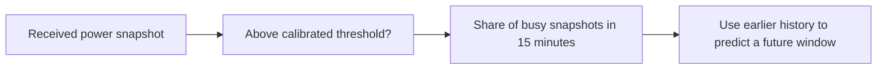

# Spectrum Occupancy Forecasting: an AERPAW deep dive

**Can a computer learn to predict how busy a Wi-Fi channel will be, and does that beat a simple rule
of thumb? A careful look at one public radio dataset, including what happens when most measurements
are missing.**

[](https://github.com/awiecz/spectrum-occupancy-forecasting/actions/workflows/ci.yml)

## The short version

- **With complete measurements, a simple rule is very hard to beat.** "The next 15 minutes will
  look like the last two hours" held up against every learned model tried: six families of them.
- **With about 99% of measurements missing, learned models clearly beat that rule, but not a
  better rule.** Pulling the history toward the long-run average fixes most of the damage with no
  training. A learned model trained for the patchy view was not shown to beat it. We call that result
  an **honest negative**.
- **The recordings are short.** They could rule out large learned gains but would almost never
  have confirmed a small one. This repository measures that limit and says so.

New to this? Read the [story in plain language](docs/story.md), then keep the
[glossary](docs/glossary.md) open.

## The question

Radio monitors measure how strong signals are, and operators may want to know how busy a channel
will be soon. How useful are recent measurements for that, and what happens when they are missing
or late? The main task forecasts the busy share of a **15-minute period starting 15 minutes ahead**:
a forecast made at noon concerns **12:15–12:30**.

## What was measured?

Public [AERPAW recordings](https://doi.org/10.5061/dryad.hmgqnk9zn) (a wireless research
testbed) contain repeated sweeps: snapshots of received radio power across frequencies. We study a
band centered at 2437 MHz, associated with Wi-Fi channel 6, at an **urban site (CC1)** and a
**rural site (LW1)**, in February 2022. The first continuous recordings cover seven and 4.75 days.



A 30% busy fraction means 30% of sampled measurements exceeded the threshold. It does **not**
measure decoded traffic, who is transmitting or channel capacity. The first day establishes each
site's threshold; later measurements use that fixed definition.


*What to notice: activity comes in stretches, with occasional jumps. Shading marks calibration;
blank heatmap cells indicate incomplete evidence. These few days do not establish a daily cycle.*

The definition of "busy" matters. At the rural site, moving the threshold from +2 to +4 dB cuts
detected activity from 30.15% to 0.70% of later snapshots. The [data study](docs/data_study.md) explains the
measurements, gaps and labeling.

## What did we find?

**Act 1: complete input.** Recent history is a strong forecaster. A learned mixture reduced error by
**1.35% urban and 6.80% rural** against history chosen on earlier data, but a fixed two-hour average
still did better at both sites on those same windows. Further attempts (local adaptation with 145
declared settings, residual corrections, a five-minute count model) did not improve things reliably;
the count model raised first-session rural error by 22.68%. **History remains the recommended method
when input is complete.** See the [results overview](docs/results.md).


*What to notice: forecasts follow the observed level and miss sudden changes. The learned method was
chosen during exploratory development, so this does not show superiority on unseen recordings.*

**Act 2: could we have known?** A [power analysis](docs/power_analysis.md) asks whether these
recordings could have shown a small gain. They could not: a true 5% improvement would be confirmed on
all three recordings only 3.5% of the time even under optimistic assumptions. The negative results
rule out large learned gains, not small ones.

**Act 3: when most measurements are missing.** A pre-declared
[sparse-regime study](docs/sparse_regime.md) trained and selected learned models for a view where
about one sweep in a hundred is visible. At the urban site, plain history's squared error was 0.0459;
the strongest simple baseline reached 0.0146 and the learned model 0.0126. A 13.3% gain over the
stronger baseline cannot be told apart from zero, so the rule's verdict is an honest negative.


*What to notice: plain history collapses without data, but pulling it toward the average removes most
of the damage. The learned model is only slightly lower at the urban site and no better at the rural site.*

## How sure are we?

Not very, and the repository says why. Three recordings at two sites in one month; sparsity is
simulated by hiding measurements, not recorded from failing sensors; every recording was inspected
many times while methods were developed, so all results are *exploratory*; and **CC2**, a third site
held back as an independent final test, has not been run. Every number quoted here is checked
against the saved result files in the [claim-to-evidence table](docs/claims.md).

## Explore or reproduce

| I want to… | Go to |
|---|---|
| Read the story without jargon | [Story](docs/story.md), [glossary](docs/glossary.md) |
| See the data | [Data study](docs/data_study.md) |
| See all findings and their limits | [Results overview](docs/results.md) |
| Browse every chapter | [Project guide](docs/index.md) |
| Run the code | [Reproduction guide](docs/reproduction.md) |
| Check methods and protocols | [Technical reference](docs/technical/index.md), [two-page note](docs/research_note/research_note.pdf) |

Try the data-study workflow without downloading recordings:

```bash
uv sync --locked
uv run python scripts/study_data.py --mode synthetic-rehearsal --out-dir reproductions/data_demo
```

This uses generated data, visibly labeled synthetic. Real-data reproduction needs roughly 32 GB of
recordings; reading the saved results needs no downloads.

Code: [MIT](LICENSE). Data: CC0 with [attribution](DATA_ATTRIBUTION.md). [Citation](CITATION.cff).
