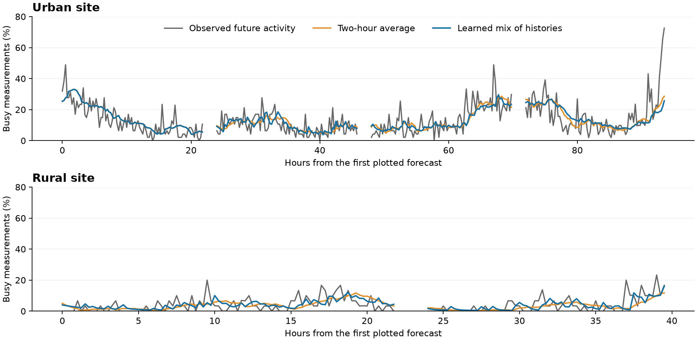

# Spectrum Occupancy Forecasting

**Predicting how busy a radio channel will be from recent measurements.**

[](https://github.com/awiecz/spectrum-occupancy-forecasting/actions/workflows/ci.yml)

How useful are recent radio measurements when we need to predict future activity—and when
those measurements are missing or out of date? This project compares simple recent averages
with trained forecasting models on public measurements of a 2.4 GHz channel.

The main task predicts the busy share of a **15-minute period starting 15 minutes ahead**.
A forecast made at 12:00 therefore concerns 12:15–12:30. A busy share of 30% means that about
30% of the measurements in that period exceed the activity threshold.

## What we found

- **Recent averages are strong predictors.** Trained models did not establish a reliable advantage over simple history-based forecasts.
- **Old measurements become less useful.** For one short-memory forecast, predictive skill roughly halved when its newest observation was 45–80 minutes old.
- **The definition of “busy” matters.** Small changes in the detection threshold can substantially change activity labels.

A learned mix of recent histories reduced squared prediction error by **1.35% at the urban
site and 6.80% at the rural site**, compared with history selected using earlier validation.
However, a fixed two-hour average still had lower error at both sites in that comparison.
The learned method missed our requirement of at least 5% improvement on each site.



*Each forecast predicts a 15-minute future period. Curves use saved evaluation predictions;
the learned method was chosen during exploratory development.*

## Data and limits

We use public [AERPAW measurements](https://doi.org/10.5061/dryad.hmgqnk9zn) from February 2022:
about **seven days at an urban site and five days at a rural site**. The channel is centered
at 2437 MHz (Wi-Fi channel 6). Activity is inferred from received power; transmissions are
not decoded. Missing and delayed measurements are simulated.

The recordings are short and were reused during development. Results are exploratory and
do not establish performance at new sites or times. An unused third-site recording remains
reserved for future evaluation and has not been inspected.

## Explore the project

- [Results overview](docs/results.md): findings and what they mean.
- [Three-page research note](docs/research_note/research_note.pdf): a short research summary.
- [Reproduction guide](docs/reproduction.md): setup and commands.
- [Technical reference](docs/technical/index.md): methods, detailed evidence and protocols.

## Try it without downloading data

With [uv](https://docs.astral.sh/uv/getting-started/installation/) and Python 3.11 or 3.12:

```bash
uv sync --locked
uv run python scripts/run_synthetic_demo.py
```

Example results and figures appear in `reproductions/synthetic_demo/`. The demo uses generated
data; its scores are not research findings. Full reproduction requires about 32 GB of recording
downloads. See the reproduction guide for details and test commands.

Code: [MIT](LICENSE). Data: CC0, with [source attribution](DATA_ATTRIBUTION.md).
Citation: [CITATION.cff](CITATION.cff).
