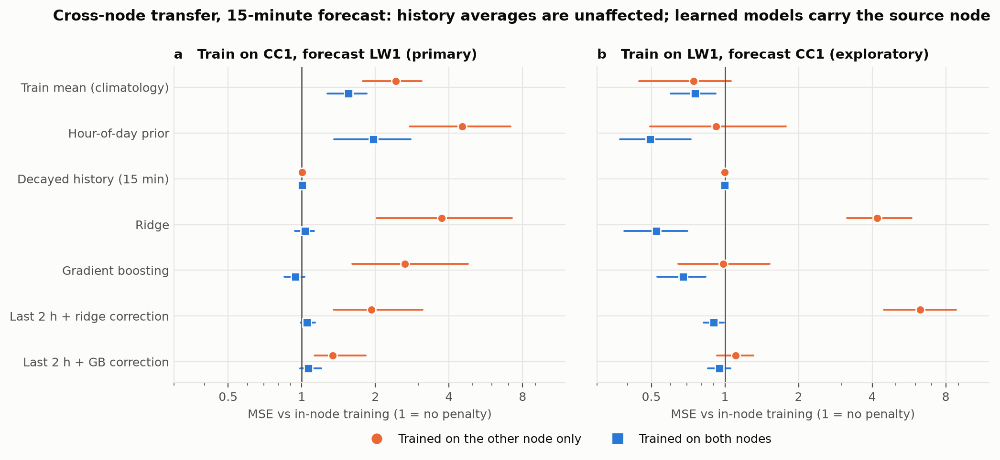

# Spectrum Occupancy Forecasting

**Spectrum occupancy prediction under sparse RF monitoring**, on real public measurements.

[](https://github.com/awiecz/spectrum-occupancy-forecasting/actions/workflows/ci.yml)
&nbsp;New here? Start with the [documentation index and repository map](docs/index.md).

> Status: **first complete study done** (two nodes, one week each, one band). Held-out test regions
> evaluated once under pre-registered protocols; see [docs/test_results.md](docs/test_results.md) (what
> held, what did not), [docs/lw1_results.md](docs/lw1_results.md),
> [docs/transfer_results.md](docs/transfer_results.md),
> [docs/sanity_checks.md](docs/sanity_checks.md) (is the signal real? how much independent data is
> there?), [docs/dev_results.md](docs/dev_results.md) and
> [docs/dataset_investigation.md](docs/dataset_investigation.md) (data provenance and quirks).

**Headline.** AERPAW nodes CC1 (urban) and LW1 (rural); the measured quantity is power in the
2.4 GHz channel-6 band (activity consistent with Wi-Fi, not decoded); forecasting the busy share of
the next 5-60 min. Controls that the signal is real (negative control, receiver drift, spectral
shape) are in [docs/sanity_checks.md](docs/sanity_checks.md).

1. **Evidence ages within about an hour.** For a short-memory estimator, forecast skill falls to
   half when the newest usable sweep is 45-80 min old (on both nodes); long-memory averages and
   boosting degrade more slowly.
2. **Occupancy labels depend on calibration.** A ~1 dB difference in noise floor changes the busy
   prevalence 2-25x, so a busy/idle label from uncalibrated power is meaningful only relative to a
   node's own floor, and cannot be compared across nodes by an absolute threshold.
3. **Single sweeps are nearly unpredictable; the busy share of the next 5-60 min is predictable
   mostly from the recent level** (within-region R^2 0.2-0.8).
4. **Learned models never clearly beat tuned moving averages.** Read this with care: the models were
   trained on only 2-5 days, each evaluation set holds only about 33-72 effective independent windows
   (AR(1) estimate), and the reported intervals are probably too narrow. Models trained on the *other*
   node mostly lose (1.3-3.7x in MSE for CC1 -> LW1 at 15 min, up to 8x for ridge; boosting did not lose
   in the reverse direction) while history averages transfer unchanged.
5. The best memory length was not stable across days or nodes, and robustness differs sharply
   between methods (simple averages degrade gracefully; a clean-trained ridge model is unstable).

Registered predictions that failed are reported as failures: two of four on CC1's test region, one of
four on LW1, one of four in the transfer analysis. This is an exploratory study of two weeks of two
nodes, not evidence about other sites, seasons or bands.


**Second node (LW1, rural; design frozen on CC1, confirmation run, see
[docs/lw1_results.md](docs/lw1_results.md)):** only the channel-6 band showed activity and the node is much
quieter. Learned models again did not beat the best simple history (N1, N3, N4 supported; N2
rejected: gradient boosting was fine here), while the best memory length again differed from CC1's
development days. Two of the four CC1 hypotheses and one of the four LW1 hypotheses failed and are
reported as such.

**Cross-node transfer** ([docs/transfer_results.md](docs/transfer_results.md), pre-registered):
history averages transfer unchanged, while learned models trained on the other node usually lose:
CC1 -> LW1 at 15 min, 1.3x to 3.7x in MSE (ridge 8.2x at 60 min); LW1 -> CC1 (exploratory), ridge 4.2x
and its residual variant 6.3x, but boosting no loss. Residual-on-level models lose least in the primary
direction only; training on both nodes is a safe default. One of four
registered predictions failed (adding the other node did help boosting). A ~1 dB difference in noise
floor changes the busy prevalence 2-25x, so occupancy labels from uncalibrated power are meaningful
only relative to each node's own floor.



## Research question

How accurately can short-term RF occupancy be predicted from real monitoring records, and how do
sampling frequency, observation age and missing measurements affect reliability — in particular
the **false-idle rate** (busy channels predicted idle) and probability calibration?

Data: AERPAW fixed-node sub-6 GHz sweeps (nodes CC1 and LW1, February 2022). Sparsity is simulated by
degrading the predictor's inputs. The study was planned around the NIST *Distributed Sensing of Radio
Spectrum Occupancy Amid COVID-19* release, whose file server was unreachable throughout, so it was not
used. See `DATA_ATTRIBUTION.md`.

## What this is not

* "Occupied" means **detected activity at one sensor above a power threshold** — not transmitter
  activity, interference at another receiver, or permission to transmit.
* A predicted-idle channel is **not** evidence that transmitting on it is harmless or authorised.
* No GNN/MARL and no live transmission. Heuristics may well beat ML; that is a
  valid result.

## Design in one paragraph

Each dwell (105 ms of 0.5 ms bins) at a (site, channel) is labelled occupied if it contains an
occupancy event above a threshold derived from training data only. Features are strictly causal and
**age-aware** (last state, time since last observation, decayed history, cross-channel evidence;
missing evidence is `NaN` + age, never 0 power or "idle"). Baselines (climatology, hour-of-week,
persistence, decayed history, age-conditioned persistence) and light ML (logistic regression,
gradient boosting) are compared under chronological splits with an embargo, then stress-tested by
degrading **only the predictor-visible stream** (dropout, contiguous outages, delay).

## Reproduce

Download `ResultsCC1Feb2022_SigMF.zip` (19 GB) from Dryad
([doi:10.5061/dryad.hmgqnk9zn](https://doi.org/10.5061/dryad.hmgqnk9zn); scripted downloads are
blocked, use a browser) into `data/raw/aerpaw/`, check its SHA-256
(`c2b1e6d9172f4738b11d78d874c2ca2e3d4232330a99d2b278eb1e05b642f747`, `scripts/sha256.py`), then:

```bash
uv run python scripts/extract_aerpaw_blocks.py data/raw/aerpaw/ResultsCC1Feb2022_SigMF.zip   # ~1 min
uv run python scripts/run_window_dev.py data/processed/aerpaw_CC1_blocks5MHz.npz              # dev only
uv run python scripts/make_figures.py data/processed/aerpaw_CC1_blocks5MHz.npz results/dev_window_forecast.json
# second node (after downloading ResultsLW1Feb2022_SigMF.zip, 12.5 GB, sha256 595e7ea4...11401951):
uv run python scripts/extract_aerpaw_blocks.py data/raw/aerpaw/ResultsLW1Feb2022_SigMF.zip
uv run python scripts/sanity_checks.py   # controls + evidence-age table (needs both blocks files)
```

`scripts/run_transfer.py` runs the CC1 <-> LW1 transfer analysis (one-shot, `docs/transfer_protocol.md`).
`scripts/run_test_once.py` evaluates the frozen design on the held-out test region and refuses to run
twice (see `docs/test_protocol.md`); its recorded output is in `results/test_window_forecast.json`.

## Development

```bash
uv sync
uv run pytest
uv run ruff check .
```

If the repository lives in a OneDrive/Dropbox-synced folder, `uv` may fail to rebuild `.venv`
("access denied"): point it elsewhere, e.g. `UV_PROJECT_ENVIRONMENT=C:/venvs/rfsi`, or run
`uv run --no-sync ...`.

The tests (all on synthetic data) cover the library (units, labelling, leakage and
causality, degradations, locks, transfer) and run every script end to end on a small synthetic
archive. Layout and a plan-versus-what-happened table are in [docs/index.md](docs/index.md). Raw and
processed data live in `data/` (git-ignored, not redistributed). Synthetic data
(`src/spectrum_occupancy_forecasting/data/synthetic.py`) exists for tests only and is never used for results.

## Licence

Code: MIT. Data: see `DATA_ATTRIBUTION.md` (NIST open licence; AERPAW CC0).
