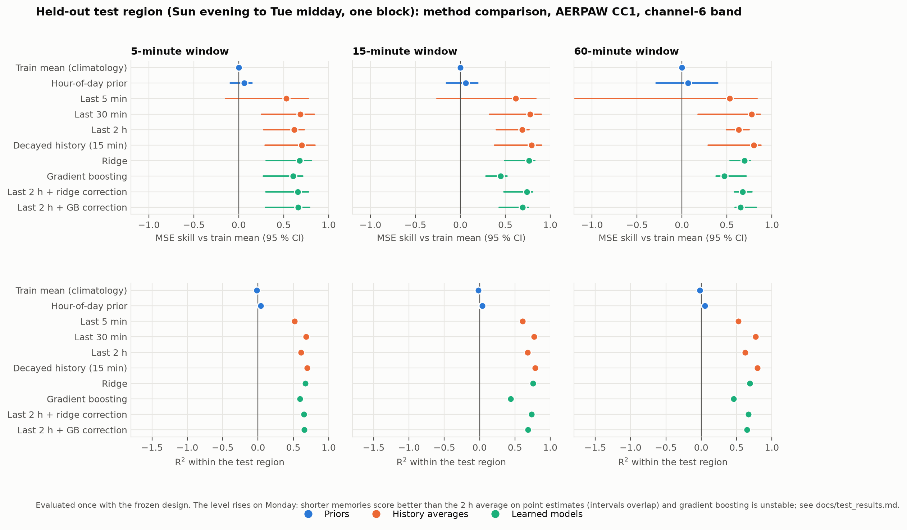

# Spectrum Occupancy Forecasting

**Short-term spectrum occupancy forecasting under sparse RF monitoring, on public measurements.**

[](https://github.com/awiecz/spectrum-occupancy-forecasting/actions/workflows/ci.yml)

Start with the [three-page research note](docs/research_note/research_note.pdf), then the
[documentation index](docs/index.md). Try the [download-free synthetic demo](#quick-start) or follow
[the full reproduction guide](docs/reproduction.md).

## Question and scope

How well can the busy share of the next 5, 15 or 60 minutes be forecast from past RF measurements,
and how does forecast quality change when those measurements are missing or stale?

This is a completed **exploratory study** of AERPAW fixed nodes CC1 (urban) and LW1 (rural), recorded
in February 2022. The analyzed main sessions span approximately **7.0 days on CC1 and 4.75 days on
LW1**. The target is power-derived activity in the 2437 MHz channel-6 band, consistent with Wi-Fi
but not decoded. Sparsity is simulated by degrading predictor inputs; targets use the intact stream.

## Main findings

1. **Evidence ages quickly.** For a short-memory estimator, skill falls to half when the newest
   usable sweep is about 45-80 minutes old. Longer-memory averages and boosting retain skill longer.
2. **Labels depend on calibration.** Applying another node's absolute thresholds (noise floors
   differ by about 1 dB) changes busy prevalence by 2-25x. Cross-node labels need careful calibration.
3. **Tracking the recent activity level explains most forecast skill.** Learned models did not
   clearly outperform the best simple histories in this study; preferred memory lengths changed
   across days and nodes. Clean-trained ridge was unstable under sparse or delayed evidence, and
   models trained on the other node usually lost skill.

These are limited observations from two short sessions and one band. Models had only 2-5 days of
training data; evaluation sets contain about 33-72 effective independent windows by an AR(1)
approximation, and the two-hour bootstrap intervals may be too narrow. Nearby model rankings remain
unresolved. Pooling nodes was approximately neutral or beneficial for the tested learned models;
this does not establish a generally safe pooling strategy.



The [CC1 test results](docs/test_results.md), [LW1 results](docs/lw1_results.md), and
[transfer results](docs/transfer_results.md) report all planned predictions, including failures.
Protocols were written before their corresponding evaluations according to the project record;
the repository does not provide evidence of external or independently timestamped registration.
Original protocols and run locks are preserved. LW1 channel selection overlaps part of its first
evaluation fold, so the pooled LW1 results are not an entirely independent confirmation. See the
[protocol and fingerprint caveats](docs/index.md#protocols-and-historical-locks) and
[measurement sanity checks](docs/sanity_checks.md).

## V2 scientific follow-up

The separate [v2 report](docs/followup_v2_results.md) adds explicit forecast leads, earlier-only
model/history selection, first-day calibration, feature ablations, label sensitivity and paired
temporal-block uncertainty. The primary target is a 15-minute busy fraction **starting 15 minutes
ahead**. On reused CC1/LW1 recordings, the validation-selected learned strategy has 8.7%/5.5%
higher MSE than independently selected history. Eight-hour intervals include no difference;
LW1 has only eight blocks. Individual family improvements and unsuccessful event calibration
are reported alongside these primary outcomes.

This is exploratory follow-up, with auditable [saved predictions and reports](results/followup_v2/exploratory_20261004/).
It preserves the historical protocols, locks and results. The [CC2 protocol](docs/followup_v2_protocol.md)
is prepared privately; confirmation remains blocked until the frozen package has an independently
verified timestamp. CC2 has not been inspected. See [v2 commands and archive gating](docs/followup_v2_reproduction.md).

## Historical experimental design

Each AERPAW sweep supplies a band-mean power snapshot (averaged in linear power). A sweep is labeled
busy when the band mean exceeds the channel's training-period fifth-percentile noise floor by
3 dB. The target is the **fraction of observed sweeps** labeled busy in a future window, an occupancy
proxy rather than a directly measured continuous-time duty cycle. Windows need at least 80% of the
expected sweep count; the expected interval is about 19 seconds on CC1 and 30 seconds on LW1.

Features use only sweeps that ended before the forecast origin, accounting for simulated delay:
recent and decayed activity, mean power, observation age and cross-channel evidence. Missing values
remain explicit. Baselines are the training mean, hour-of-day prior, 5-minute/30-minute/2-hour
history averages, and decayed history. Learned models are ridge, gradient boosting, and corrections
to the 2-hour history. Chronological folds have a look-back-plus-target-window embargo; preprocessing
is fitted on training periods. Dropout, contiguous outages and delay affect predictor inputs only.
Equal-false-busy event comparisons use evaluation-label oracle thresholds and describe ROC operating
points, not deployment guarantees.

Detected activity at one sensor does not establish transmitter identity, interference elsewhere,
or permission to transmit. A predicted-idle band does not imply transmission would be harmless.

## Quick start

Install [uv](https://docs.astral.sh/uv/getting-started/installation/) and use Python 3.11 or 3.12
(the versions tested in CI). From the repository root:

```bash
uv sync --locked
uv run python scripts/run_synthetic_demo.py
```

The demo creates a small synthetic spectrogram, fits all ten base models for a 15-minute target,
and writes clearly labeled synthetic JSON, PNG/PDF figures and a plotted-values CSV under
`reproductions/synthetic_demo/` (git-ignored). It uses one evaluation day, 100 bootstrap resamples
and no robustness grid. **Demo output is not evidence for the real-data findings.**

To reproduce the study, download the two archives from
[Dryad](https://doi.org/10.5061/dryad.hmgqnk9zn) (about 32 GB total); follow
[docs/reproduction.md](docs/reproduction.md) for extraction, separate output/lock paths, and figures.
Raw and processed recordings are git-ignored and not redistributed. The planned NIST dataset was
not used because its file server was unavailable during the project; see [data attribution](DATA_ATTRIBUTION.md).

## Development

```bash
uv run pytest
uv run ruff check .
```

Tests use synthetic data and cover units, labels, causality, degradations, locks, transfer, and
script integration. If a synced OneDrive/Dropbox folder prevents environment creation, set
`UV_PROJECT_ENVIRONMENT` to a directory outside that folder before running `uv sync --locked`.
For example, in PowerShell: `$env:UV_PROJECT_ENVIRONMENT = "C:/venvs/spectrum-occupancy"`.

## License and citation

Code: MIT. Data: AERPAW CC0; see [DATA_ATTRIBUTION.md](DATA_ATTRIBUTION.md).
Citation metadata is in [CITATION.cff](CITATION.cff).
