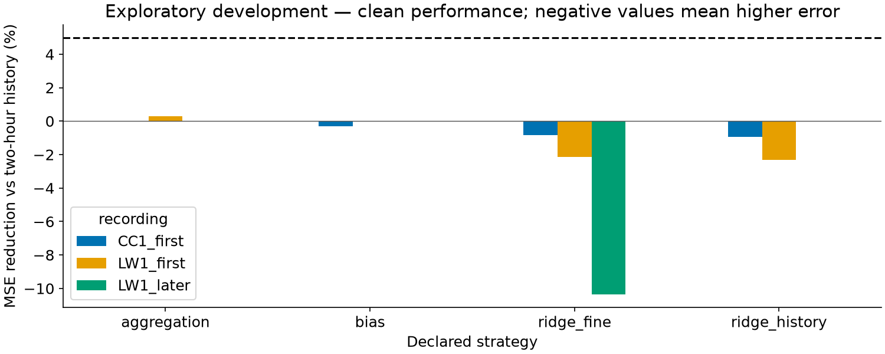
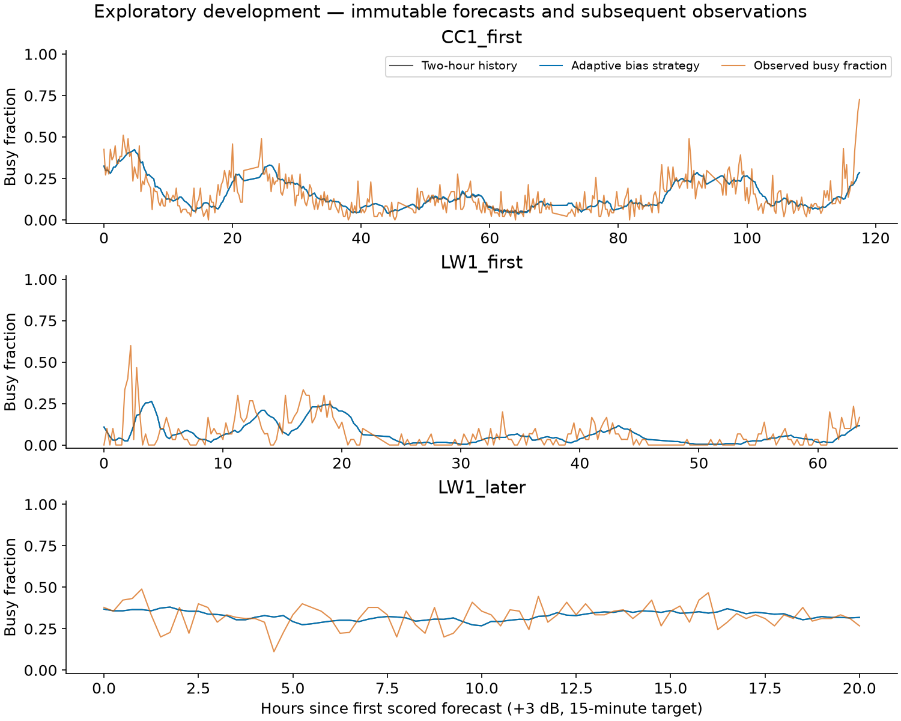
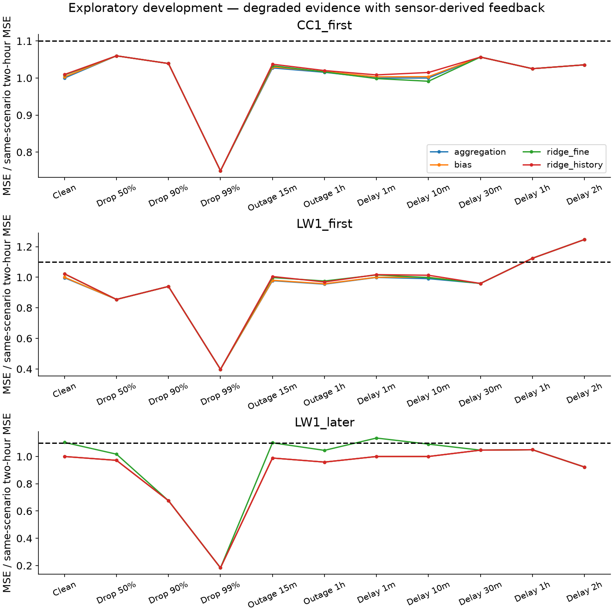
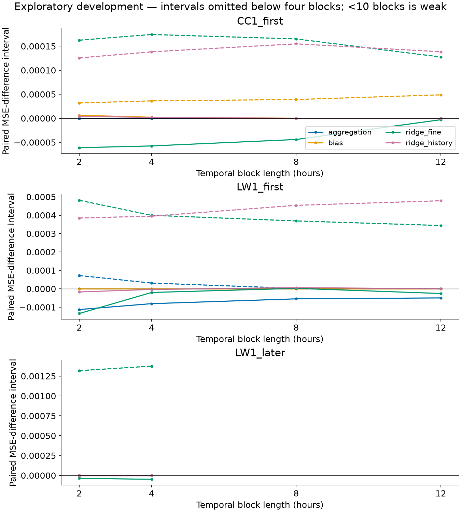

# Can local learning improve occupancy forecasts?

**The declared adaptive search did not establish a reliable learned advantage. Two-hour history
remains the recommended default, with selected history used when the adaptive controller lacks
fresh evidence.** This is a completed exploratory investigation; all three recordings were already
inspected before this study. The unused CC2 recording remains untouched.

## Why try adaptation?

A sweep is a received-power snapshot. The target is the share of snapshots above a frozen,
recording-specific first-day threshold in the 15-minute window starting 15 minutes ahead.
At noon, the forecast concerns 12:15–12:30. This label measures neither decoded traffic nor
channel capacity. The [data study](data_study.md) explains calibration and coverage.

The previous frozen-transfer experiment underpredicted the later rural recording. Its 81
predictions had mean error about −8.8 percentage points, and MSE was 160.45% higher than fixed
two-hour history. A persistent downward learned correction was inappropriate for that recording.
The mean correction was −9.06 percentage points and eight corrections reached the −0.1 cap,
although two-hour history's mean error was only +0.26 percentage points. These values are
recorded in the [saturation diagnosis](../results/adaptive_learning/audit/transfer_saturation.csv).
Its activity level and normalized power distributions differed from first-session development.
This motivated learning from completed local measurements, rather than carrying a frozen
correction across recording gaps. Distribution shifts are descriptive observations, not proof
of a particular transmitter or causal mechanism.

The [pre-adaptation audit](../results/adaptive_learning/audit/previous_bias.csv) reproduces
the old losses from saved predictions. [Calibration and input summaries](../results/adaptive_learning/audit/input_distributions.json)
separate the first day from subsequent activity. Original prediction and fitting-manifest bytes
are retained in [prior evidence](../results/adaptive_learning/references/).

## What was declared and implemented?

Each recording starts afresh after its first 24 hours. Those measurements supply calibration,
initial local training and training-only preprocessing. Histories and learned state reset at
the recording gap. All scenarios share this clean initialization; simulated disruptions then
affect delivered predictor evidence and feedback. Additional, unscored 15-minute forecasts
after initialization support continuous adaptation before the scored daily folds.

At each origin, the replay processes feedback already delivered, saves an immutable forecast
and feature snapshot, then queues its future target. Feedback becomes usable only when the
entire target window has finished, plus any simulated delay. Under dropout or outage, its
busy fraction comes from delivered snapshots and requires 80% expected coverage. Missing
evidence is never treated as idle. Complete original labels are stored separately for scoring.

The bounded correction adds at most 0.1 times its selected strength to two-hour history,
then clips the result to [0,1]. Correction requires a measurement no older than 15 minutes,
50% predictor coverage, four usable completed windows in the preceding two hours, and a
newest feedback window no older than one hour. Otherwise it returns selected same-scenario
history exactly. A controller without learning measures the effect of these safety rules.

| Family | Declared candidates | What changes after feedback? |
|---|---:|---|
| Bias correction | 12 | Exponentially weighted residual mean |
| History aggregation | 36 | Weights over eight issued history forecasts |
| Residual ridge | 96 | Local weighted regression statistics; history or history plus fine power |
| History-only controller | 1 | No learned correction |

The full grid and safety settings are in [adaptive_learning.yaml](../configs/adaptive_learning.yaml).
No calendar, cross-channel or site-identity features enter the learned models. Ridge imputation,
missing indicators and scaling are fitted on initialization examples and then frozen. Exponential
forgetting updates ridge statistics while retaining its regularization prior.

Selection and adaptation are different operations. Each eligible daily fold selects settings
using two earlier six-hour validation replays ending ten hours before evaluation. Their training
targets finish ten hours before each block starts. Causal feedback updates are allowed inside
each block. A learned candidate must reduce pooled validation MSE by at least 2% against both
history references and improve on both in each block; otherwise the controller is selected.
Operational states evolve continuously after calibration. Later LW1 starts with settings from
the last earlier LW1 first-session selection, then receives only its own local feedback.

## What happened?

These comparisons use the same scored origins for every strategy: 439 at urban CC1, 239 in
rural LW1's first recording, and 81 in later LW1. Positive values below mean lower MSE than
fixed two-hour history; these are relative error reductions, not percentage-point activity changes.

| Adaptive strategy | Urban first | Rural first | Rural later |
|---|---:|---:|---:|
| Bias | −0.30% | 0.00% | 0.00% |
| History aggregation | 0.00% | +0.30% | 0.00% |
| Ridge, history inputs | −0.96% | −2.30% | 0.00% |
| Ridge, history and fine power | −0.83% | −2.14% | −10.36% |

*15-minute targets at 2437 MHz, +3 dB labels, clean inputs; each bar uses all eligible scored
windows of its recording. The dashed line marks the 5% promotion criterion. Selection often
returns the controller, so a zero gain does not demonstrate successful learned adaptation.*

*Urban first, rural first and rural later; the illustrated bias strategy uses the same targets
as two-hour history. Observations are subsequent scoring labels, not information available at
forecast issuance. Busy fraction is dimensionless; elapsed time starts at the first scored origin.*

The safety-only controller has zero clean gain against fixed two-hour history on all three
recordings. Its degraded-input comparisons are reported separately from learned gains.
The fine-power strategy is substantially less harmful on later LW1 than frozen transfer was,
but remains worse than history. That comparison involves different training and update rules
on already-inspected data; it is not independent evidence of improvement. Aggregation's 0.30%
first-session rural gain is too small, and selected history is better there. No family qualifies.

## Robustness and uncertainty

*Each ratio compares MSE with the same scenario's two-hour history on identical targets. Five
paired masks are used for stochastic dropout and outages; losses, rather than predictions, are
averaged across seeds. The 1.10 line marks the allowed 10% error increase. Selected-history
comparisons are also included in the saved tables and advancement decision.*

*Paired MSE-difference intervals against two-hour history use 2,000 resamples at 2/4/8/12-hour
block lengths. Blocks never cross recordings, folds or gaps. Intervals are omitted below four
blocks and flagged as weak below ten; eight hours is the main analysis. The short later
recording cannot provide a reliable eight-hour interval. At eight hours, there are 15 blocks
for urban CC1, eight for first-session rural LW1 (weak evidence), and three for later LW1
(interval suppressed). Changing block length does not remove
the short-record or repeated-development limitations.*

[Saved outputs](../results/adaptive_learning/run/) include daily and pooled metrics, all candidate
validation scores, frozen selections, clean candidate forecasts, feature snapshots, feedback
and skipped updates, period summaries, event thresholds and denominators, and the
[machine-readable advancement decision](../results/adaptive_learning/run/advancement.json).
Event thresholds are calibrated on earlier validation only; insufficient event counts are explicit.
The [experiment ledger](../results/adaptive_learning/experiment_ledger.csv) retains earlier
unsuccessful outcomes and the declared adaptive search. Detailed superseded implementations
and outputs are checksum-verified in the local archive recorded by the
[cleanup receipt](../results/adaptive_learning/archive_receipt.json).

## Reproduction and limits

The [reproduction guide](reproduction.md#adaptive-local-learning) provides synthetic rehearsal,
existing-cache replay and prediction-only reporting commands. Synthetic results are visibly
labeled and are not evidence for these findings. No new raw extraction or downloads occurred.

Passing causality tests and reproducing saved comparisons makes the investigation auditable;
it does not make a negative performance result positive. The declared search ends here.
All inspected recordings, including later LW1, are development data. CC2 protocols remain
unchanged, and any future adaptive confirmation needs a separate frozen protocol specifying
feedback updates. No current result establishes independent or broad learned-model superiority.
