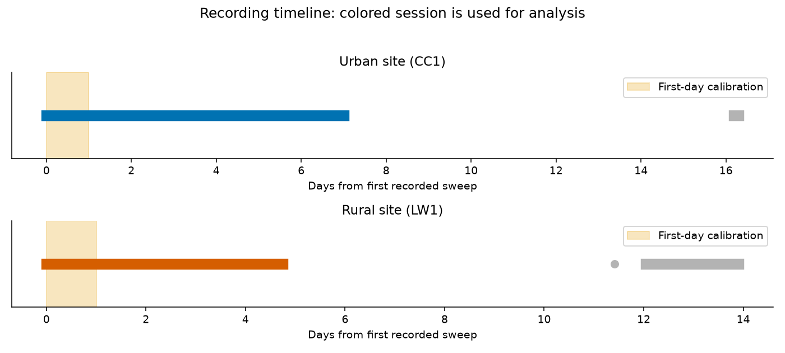
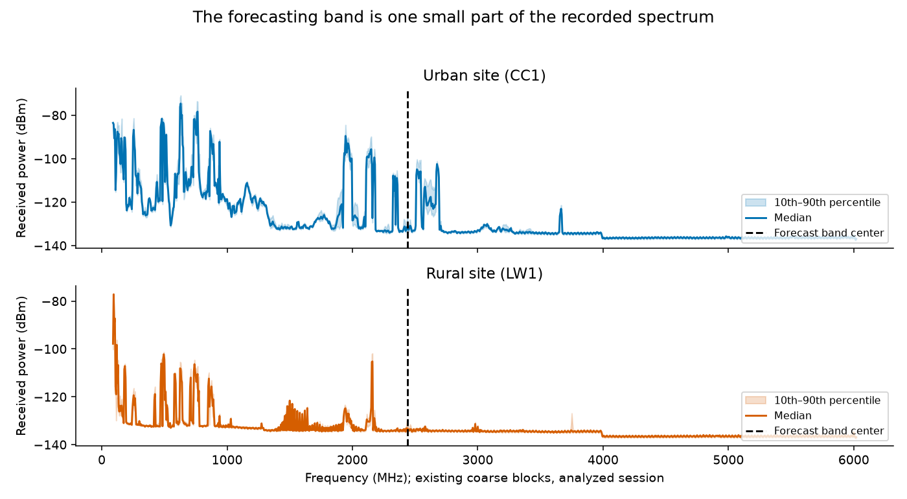
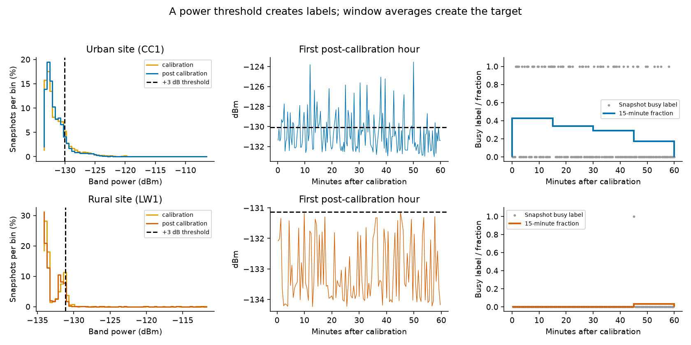
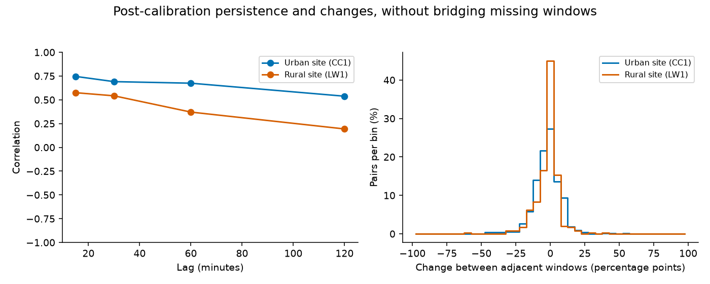
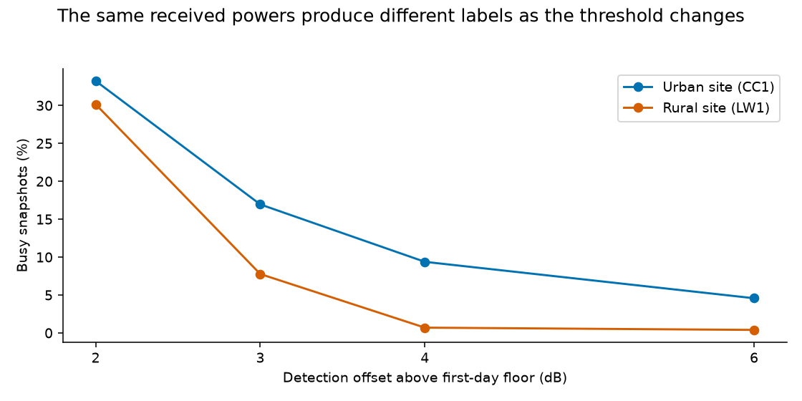

# Explore the measurements

**Recent radio activity persists, occasional changes interrupt it, and the definition of
“busy” strongly affects the picture.** This study explains the data behind the forecasting
project before comparing models. It uses previously inspected recordings, so its observations
are descriptive findings rather than an independent test of a new hypothesis.

## What was recorded, and how complete is it?

A stationary receiver repeatedly swept through radio frequencies, saving received power.
Each sweep is a snapshot: it tells us how strong the received signal was around a frequency
at that visit. It does not decode messages, identify an application or continuously observe
transmissions between visits. The urban site is **CC1** and the rural site is **LW1**.

| Inventory | Urban (CC1) | Rural (LW1) |
|---|---:|---:|
| All recorded snapshots | 32,529 | 21,617 |
| Separate sessions | 2 | 3 |
| Calendar span of archive | 16.30 days | 13.91 days |
| Analyzed first session | 7.00 days | 4.75 days |
| Snapshots in analyzed session | 32,018 | 13,620 |
| First-session interval: 10th / median / 90th percentile | 18 / 19 / 20 seconds | 30 / 30 / 31 seconds |
| Complete 15-minute windows | 671 | 455 |
| Windows excluded for low coverage | 0 | 0 |
| Incomplete final windows excluded | 1 | 1 |

The first sessions run from February 8, 2022, at 17:50:34 UTC to February 15 at
17:50:24 UTC for CC1, and February 8 at 17:57:56 UTC to February 13 at 11:55:33 UTC
for LW1. Longer archive spans include substantial recording gaps, not two weeks of
continuous evidence. Later sessions remain in the inventory; target-band analysis uses
session 0 to match the forecasting pipeline. A gap exceeding five minutes starts a new session.

*Both archives, February 2022: colored lines mark the analyzed first sessions; gray marks
other sessions, including a single rural snapshot. Shading marks first-day calibration.*

For every complete window, we require at least 80% of its expected snapshots. Expected counts
use each site's first-day median sweep interval. Neither first session loses a complete window
to this filter; the final tails of 890 seconds urban and 757 seconds rural are excluded.
Good coverage supports usable labels, but cannot reveal transmissions between snapshots.

## Where does the forecasting band sit?

The recordings cover a broad spectrum. Existing preprocessing compresses individual frequency
bins into approximately 5 MHz blocks. The figure shows each block's median power and the range
between its 10th and 90th percentiles across the analyzed session.

*First sessions at both sites: power in dBm across the recorded spectrum, with 2437 MHz marked.
Percentile bands describe variation across snapshots, not confidence intervals.*

The forecasting task concerns the approximately 20 MHz band centered at 2437 MHz, conventionally
associated with Wi-Fi channel 6. Peaks elsewhere provide context; they do not identify services
or transmitters. Instrument calibration is insufficiently documented to interpret absolute
differences between the two receivers as differences in transmitter strength. Consequently,
labels use a floor estimated separately for each site.

## How does power become a busy label?

Band power is calculated by averaging block powers in **linear units**, then converting back
to dBm. Averaging the displayed dBm values directly would produce a different measurement.
The first 24 hours establish a noise-floor proxy: the fifth percentile of band power. The
primary threshold is that floor plus 3 dB, frozen for the rest of the session.

| Calibration | Urban (CC1) | Rural (LW1) |
|---|---:|---:|
| First-day snapshots | 4,524 | 2,869 |
| Floor proxy | −133.08 dBm | −134.14 dBm |
| Primary threshold | −130.08 dBm | −131.14 dBm |
| First-day busy snapshots | 21.93% | 14.29% |
| Later busy snapshots | 16.95% | 7.77% |

A snapshot above the threshold receives label 1; otherwise it receives 0. The mean label in
a 15-minute window is its **busy fraction**. Forty percent means four out of ten sampled
snapshots were above the threshold. It is not a direct estimate of transmitter duty cycle,
decoded traffic volume or available channel capacity.

*Each site's analyzed session: distributions separate first-day and later snapshots. The
example hour is fixed as the first hour after calibration; lines show the +3 dB threshold
and 15-minute fractions. Histogram percentages use each period's snapshot count.*

This example was chosen by a time rule, not for dramatic activity. Missing snapshots never
become zero labels: an inadequately covered window is unavailable rather than idle.

## How does activity vary?

*Both first sessions, +3 dB labels: non-overlapping 15-minute fractions; shading marks
calibration. Heatmap hours group windows by their local start hour in America/New_York
(UTC−5 here); a cell requires four eligible windows. Blank cells mean incomplete evidence.*

Activity changes substantially within and between days. Some periods have little detected
activity; others contain sustained clusters of busy snapshots. The post-calibration urban
prevalence is 16.95% over 27,494 snapshots; rural prevalence is 7.77% over 10,751 snapshots.
These denominators include the final partial tail, whereas window summaries exclude it.

The [daily tables](../results/data_study/CC1_daily.csv) and
[rural counterpart](../results/data_study/LW1_daily.csv) report snapshot counts, busy counts,
eligible/excluded window counts and the 10th, median and 90th percentiles of window fractions.
Calibration and later data are separated. Daily grouping uses local dates; window summaries
are assigned by start time. Heatmaps make variation easy to see, but seven and fewer than five
days cannot establish a stable daily cycle or a general urban–rural difference.

## Why might recent history predict the future?

*Post-calibration windows only, +3 dB labels: lagged correlation and changes between adjacent
fractions. Pair counts are saved alongside correlations; pairs never cross excluded windows.*

The urban correlation is **0.75 at 15 minutes** and **0.54 at two hours**, based on 574 and
567 pairs. Rural correlations are **0.57** and **0.19**, based on 358 and 351 pairs.
Positive correlation means neighboring periods often resemble each other, which helps explain
why recent averages are competitive forecasting methods. It does not prove a causal mechanism.

Most adjacent changes are modest, but occasional changes are larger. Ninety percent of
absolute adjacent changes are at most **14.9 percentage points urban** and **13.3 rural**.
A move from 10% to 25% is 15 percentage points; it is a 150% relative increase. Nearby windows
are dependent, so hundreds of windows are not hundreds of independent observations. These
descriptive correlations have no independent-sample significance intervals attached.

## How dependent is the picture on the label definition?

*Post-calibration snapshots in each first session: the same powers and frozen first-day
floors, with four detection offsets. Each site's denominator stays constant across offsets.*

| Offset above floor | Urban busy snapshots | Rural busy snapshots |
|---|---:|---:|
| +2 dB | 33.23% | 30.15% |
| +3 dB | 16.95% | 7.77% |
| +4 dB | 9.38% | 0.70% |
| +6 dB | 4.58% | 0.40% |

The rural labels change particularly sharply between +2 and +4 dB. This is a sensitivity of
the measurement definition, not a change in physical traffic. All offsets retain 575 urban
and 359 rural post-calibration windows because coverage depends on observation availability,
not on how many snapshots are labeled busy. The threshold grid is descriptive and does not
select a new threshold to improve forecasting scores.

## What this means for forecasting

Persistence makes history informative; abrupt changes make some forecasts difficult.
Coverage controls prevent missing evidence from masquerading as inactivity, while threshold
sensitivity limits interpretation of “occupancy.” These observations explain the forecasting
question and support careful baselines, without establishing learned-model superiority.
Read the [forecast results](results.md) for that separate comparison.

Every figure is generated from [saved summary and source tables](../results/data_study/);
the [reproduction guide](reproduction.md#reproduce-the-data-study) provides one command.
The [historical measurement checks](technical/sanity_checks.md) use different periods and
whole-period floor estimates; their values should not be substituted for this first-day study.
No new models were fitted, and the reserved third site was not inspected.
