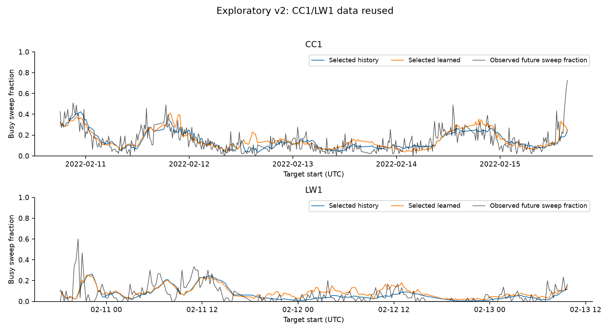
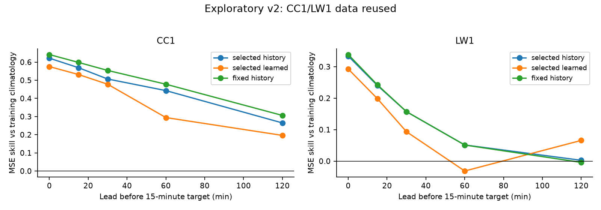
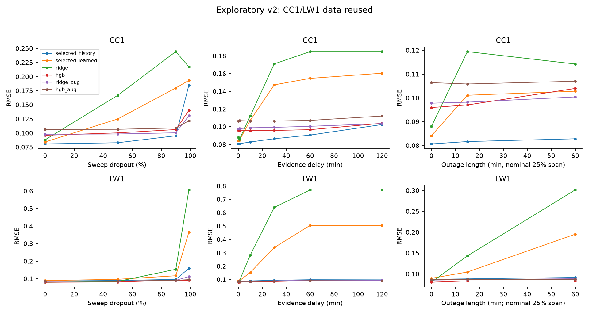

# V2 exploratory follow-up: reviewed results

Run: `results/followup_v2/exploratory_20261004_boundfix`. This is exploratory reuse of CC1/LW1,
not fresh confirmation. Historical studies, their protocols, locks and numerical outputs
remain separate. CC2 is uninspected and confirmation is pending independent timestamping.

The primary target is the busy sweep fraction in a 15-minute window **starting 15 minutes
after the forecast origin**, at 2437 MHz. Each node uses frozen first-day calibration and
floor +3 dB labels. Five CC1 folds provide 439 eligible origins; three LW1 folds provide 239.
The final LW1 partial fold is retained. Targets end inside their folds. Inner and outer
origin grids reserve space for the maximum two-hour lead. The same grid spacing does not
guarantee identical eligible origins if future recordings have lead-dependent coverage gaps.

## Primary comparison

All rows below come from [summary.csv](../results/followup_v2/exploratory_20261004_boundfix/summary.csv).
Skill means `1 - MSE(method)/MSE(selected history)` on paired targets.

| Node | Method | RMSE | MAE | Within-fold R² | Skill vs selected history |
|---|---|---:|---:|---:|---:|
| CC1 | Selected history | 0.08069 | 0.05838 | 0.408 | 0 |
| CC1 | Fixed two-hour history | 0.07792 | 0.05708 | 0.448 | +0.067 |
| CC1 | Selected learned strategy | 0.08413 | 0.06286 | 0.356 | −0.087 |
| CC1 | Training climatology | 0.12291 | 0.10239 | −0.375 | −1.321 |
| LW1 | Selected history | 0.08718 | 0.05638 | −0.149 | 0 |
| LW1 | Fixed two-hour history | 0.08707 | 0.05591 | −0.147 | +0.003 |
| LW1 | Selected learned strategy | 0.08956 | 0.06379 | −0.213 | −0.055 |
| LW1 | Training climatology | 0.10004 | 0.08453 | −0.514 | −0.317 |

The primary learned strategy does **not** beat independently selected history on either node.
This strategy selects a family before each outer fold; it is not the best family chosen after
evaluation. LW1 ridge and boosting family rows have positive skill of 0.156 and 0.154, but the
earlier validation procedure did not reliably choose them. These are secondary outcomes.
CC1's selected history also loses to the fixed two-hour reference: selection has a cost here.

The eight-hour paired bootstrap MSE-difference intervals are −0.000493 to +0.001788 for CC1
(15 blocks), and −0.000557 to +0.001509 for LW1 (8 blocks, **weak evidence**). Corresponding
skill intervals are −0.340 to +0.061 and −0.537 to +0.051. All four block-length sensitivities
include zero difference. Intervals with fewer than four blocks are suppressed, including in
the synthetic rehearsal. Blocks never cross nodes, folds or observation gaps. These sensitivity
checks do not resolve the short-record limitation. See [bootstrap.csv](../results/followup_v2/exploratory_20261004_boundfix/bootstrap.csv).

Daily selected-strategy skills are CC1: +0.163, −0.773, −0.134, −0.150, +0.042; LW1:
+0.063, −1.133, −0.004 (zero-based fold order). The pooled result hides substantial instability.
Lag-15-minute error autocorrelations are 0.399/0.329 (CC1/LW1); paired-loss-difference
autocorrelations are 0.280/0.147. [daily.csv](../results/followup_v2/exploratory_20261004_boundfix/daily.csv)
and [dependence.csv](../results/followup_v2/exploratory_20261004_boundfix/dependence.csv) retain all diagnostics.

## How far ahead is there predictive information?

At leads 0/15/30/60/120 minutes, selected-history RMSE is
0.0739/0.0807/0.0872/0.0973/0.1232 for CC1 and
0.0819/0.0872/0.0916/0.0968/0.0989 for LW1. CC1 remains better than training climatology
at all tested leads in point estimates; LW1's history advantage is effectively gone by two
hours. This establishes predictive information in these recordings, not an operationally
acceptable horizon. The selected learned strategy is worse than history at every CC1 lead;
LW1 has a small two-hour reversal (0.0957 versus 0.0989), a secondary exploratory finding.
No lead was chosen after seeing results for confirmation.

## Label sensitivity

Mean target fractions and event counts change sharply. Counts are nonoverlapping evaluated
target windows, not independent events. Observations total 21,005 on CC1 and 7,140 on LW1
under each definition. All candidate selection is repeated at each offset.

| Node | Offset dB | Mean fraction | Windows | Windows ≥0.2 | Learned skill vs selected history |
|---|---:|---:|---:|---:|---:|
| CC1 | 2 | 0.3101 | 439 | 348 | +0.046 |
| CC1 | 3 | 0.1481 | 439 | 107 | −0.087 |
| CC1 | 4 | 0.0803 | 439 | 35 | −0.051 |
| CC1 | 6 | 0.0409 | 439 | 5 | −0.068 |
| LW1 | 2 | 0.3031 | 239 | 227 | +0.004 |
| LW1 | 3 | 0.0701 | 239 | 22 | −0.055 |
| LW1 | 4 | 0.0085 | 239 | 3 | +0.146 |
| LW1 | 6 | 0.0047 | 239 | 0 | +0.093 |

Smaller RMSE under high thresholds partly reflects the changed, mostly idle target. Positive
relative skill on LW1 at +6 dB does not imply useful high-activity detection: there are no such
evaluation events. Rankings do not survive label changes uniformly.

## Features and degraded evidence

History-only learned variants have small positive skills (about 1.9% CC1 and 1.6% LW1), while
all-features strategies lose on both nodes. Adding power helps CC1's point estimate (about
3.2% skill) but hurts LW1's (about −1.9%). Calendar features do not improve either selected
strategy. Allowlisted ablations are exploratory comparisons; they do not isolate a universally
useful feature family. [Ablation values](../results/followup_v2/exploratory_20261004_boundfix/figures/ablations.csv).

With 90% dropout, selected-history/selected-learned RMSE becomes 0.0951/0.1800 on CC1 and
0.0966/0.1172 on LW1. At two-hour delay it becomes 0.1025/0.1605 and 0.0982/0.5056.
The clean-trained ridge family is particularly unstable under stale evidence. Augmented ridge
reduces those two-hour-delay errors to 0.1036/0.0948; augmentation costs clean-input performance
and does not establish overall superiority. At 99% dropout, selected history itself deteriorates
to 0.1849/0.1592. Targets remain identical across scenarios. All scenario skill comparisons use
the **same degraded history**; `mss_vs_clean_selected` is a separate diagnostic.
Five paired masks are averaged at the loss level for temporal inference, not counted as five
independent recordings. `mse_mask_sd` reports variability among seed-specific pooled losses.

## Frozen event thresholds and historical LW1 overlap

Only CC1 fold 2 has enough validation events and nonevents to calibrate the primary event
thresholds; 140 of 160 primary method/budget/fold calibration records are insufficient. On that
fold the selected strategy's frozen 10%/20% budget thresholds are 0.2342/0.2031. Both realize
0 false-busy out of 84 negative evaluation windows and 4 false-idle out of 4 positive windows.
That failure is retained. There is no calibrated LW1 operating-rate claim. Tied score groups
are included whole, and budgets constrain earlier empirical rates, not future guarantees.
[events.csv](../results/followup_v2/exploratory_20261004_boundfix/events.csv) contains denominators for every
scenario and mask; oracle ROC outputs remain separately labeled descriptive comparisons.

The legacy LW1 sensitivity exactly reproduces all stored pooled RMSEs (maximum difference
0.0). Excluding its overlapping first fold changes ridge skill vs fixed history from +0.184
pooled to −0.328 later-fold-only, and boosting from +0.095 to −0.651. This is retrospective
sensitivity, not fresh confirmation. [Legacy sensitivity table](../results/followup_v2/exploratory_20261004_boundfix/legacy_lw1_overlap.csv).

## Audit and pending confirmation

Every number above derives from the saved prediction files and named comparison. Seven
figure families were visually reviewed. Tests cover future corruption, calibration isolation,
lead/window boundaries, coverage, embargoes, selection order, feature exclusion, tied and
degenerate thresholds, paired masks, insufficient blocks, Parquet round trips and archive
verification. Original source modules and historical results/locks were preserved.

The initial run remains preserved under `results/followup_v2/exploratory_20261004/`.
Following code review, last-observed states and ages were bounded, raw CC2 checksum provenance
was added, and all 13 tasks were rerun in the new directory. All 275,268 prediction rows,
candidate scores, selections and operating thresholds exactly match the initial run. The
new fitting fingerprint covers the corrected code and all reporting additions. The original
local freeze package is superseded before independent archival or any CC2 inspection.

The defensible portfolio conclusion is that this repository implements and audits actual
occupancy-proxy forecasting, finds useful short-term level tracking, and exposes limitations
of validation selection, labels and evidence degradation. It does not establish learned-model
superiority or deployment-ready event detection. [The private protocol](followup_v2_protocol.md)
freezes the future CC2 comparison; confirmation remains blocked until independent archival
verification. CC2 is an additional site in the same campaign, not seasonal generalization.
