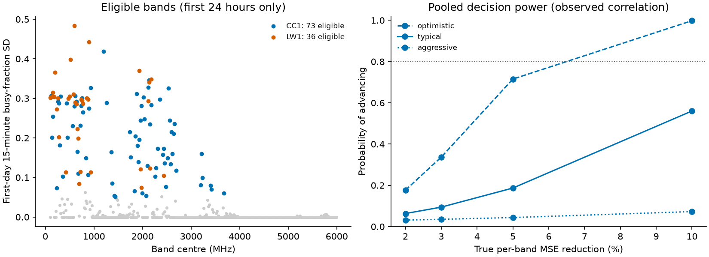

# Multi-band shared learning: draft protocol

Drafted 2026-10-05. **Status: Draft. Future work, not run, not frozen, not declared in the
registry, no model fitted.** It is not part of the current investigation's findings. Stage A
below would be development-grade evidence on recordings that were already inspected. Nothing
here is a confirmation, and CC2 is untouched.

This protocol and [`configs/multiband.yaml`](../configs/multiband.yaml) are authoritative
together. The planning numbers come from
[`scripts/multiband_inventory.py`](../scripts/multiband_inventory.py), which creates no learned
forecast. Its fixed-history baseline approximates the repository's two-hour average; the
registered run must use the repository implementation.

## Why this study, and what it can honestly deliver

The [power analysis](power_analysis.md) showed that one band on a few days cannot show a small
learned gain. This study asks whether pooling many bands lets a shared model be tested on far
more series. The planning numbers below give a sober answer: **pooling helps only a little,
because errors in different bands rise and fall together.** Stage A is therefore an estimation
and falsification stage, not a decisive test of a 5% gain.

## Question and estimand

Does a model trained on some bands lower the error of 15-minute-ahead busy-fraction
forecasts in *held-out* bands, relative to history? Targets and labels follow the single-band
task: the busy fraction of the window starting 15 minutes ahead, where busy means band power
above the recording's first-24-hour noise floor (fifth percentile) plus 3 dB.

The primary estimand is **Ḡ, the mean over evaluated bands of each band's relative MSE
reduction**, computed per site and then averaged with equal site weights. Bands carry equal
weight so a few high-variance bands cannot dominate. Ḡ is reported against both fixed two-hour
history and per-band selected history. Positive values favor the learned model.

## Data and disclosures

Data are session zero of the AERPAW February 2022 CC1 (urban) and LW1 (rural) recordings,
cached as 5 MHz blocks over roughly 89 MHz to 6.02 GHz. Later LW1 session 2 is supplementary.
All 20 MHz bands average four aligned blocks, aligned so the 2437 MHz target is band index 117.

Disclosures that limit Stage A:

- The 2437 MHz target has been inspected repeatedly on these recordings.
- Before this draft, an exploratory scan of every band used **later-period** labels (busy
  share, 15-minute variation, change correlations) on session zero. It motivated this study.
  The frozen eligibility rule below uses only the first 24 hours; the scan is not a result.
- The planning inventory below read fixed-history baseline errors over the evaluation period.
  No learned forecast was produced or scored.

## Bands and eligibility

Use non-overlapping 20 MHz bands. A band is eligible when, in the **first 24 hours only**:
every 15-minute window has at least 80% of expected sweeps; the busy share is between 2% and
98%; and the standard deviation of 15-minute busy fractions is at least 0.05. A band is
evaluated only if its reference MSE is at least 1e-4 and it has at least four 8-hour blocks;
this uses reference losses, never model losses. Excluded bands are listed, not replaced.

| Site | Bands | Eligible | Evaluated | Evaluated per band fold (0–4) |
|---|---:|---:|---:|---|
| CC1 | 296 | 73 | 73 | 18 / 17 / 12 / 17 / 9 |
| LW1 | 296 | 36 | 34 | 12 / 9 / 2 / 8 / 3 |

The target band is eligible and evaluated at both sites. Note that 26 of LW1's 34 evaluated
bands lie below 1 GHz, many with nearly identical first-day variability. They may share a source
or a receiver artefact, which motivates the frequency sensitivity below.

## Splits and causality

- **Time:** daily expanding folds starting two days after recording start, as in the follow-up
  v2 protocol. Calibration is the first 24 hours. Fitting targets finish at least ten hours
  before a fold starts; the same embargo applies inside validation. Training origins are spaced
  three minutes apart; validation uses the last twelve hours before each fold as two six-hour
  blocks.
- **Bands:** assign contiguous 100 MHz spans to five band folds (span index modulo 5). For each
  held-out band fold, train only on other folds' eligible bands, and drop bands within one
  20 MHz band of a held-out span to limit leakage from overlapping channels. Every evaluated
  band is held out exactly once per time fold.
- Each training band gets equal total weight. Band identity and frequency are never features.

## Comparators and candidates

- **Fixed two-hour history** and **selected history per band**, where each band chooses among
  the eight history candidates (moving averages and exponential histories at 5/15/30/120
  minutes) using its own earlier validation blocks.
- **Learned candidates** reuse the frozen follow-up v2 grid: ridge with penalties 1/10/100/1000,
  histogram boosting with depth 2/3 and minimum leaf size 20/40, and residual versions of
  each on selected history. Select each family and then the learned strategy by pooled
  validation MSE on *training bands only*. Ties choose the first in the frozen order.
- **Features:** history only is primary. History plus band context (first-24-hour busy share and
  variability) is a declared secondary variant.
- Report every candidate's validation score. The grid is stopped after it is run.

## Inference

Resample whole bands within each site and whole 8-hour time blocks independently (2,000
resamples, seed zero), then recompute Ḡ. This crossed scheme respects correlation across bands
that share time-of-day events, and is expected to be conservative. Report 4/8/12-hour block
sensitivity, with intervals suppressed below four blocks and flagged below ten as weak. Blocks
never cross folds or recording gaps.

## Power before modelling

Per-band standard errors scale the target band's single-band noise (optimistic, typical and
aggressive candidates from the [power analysis](power_analysis.md)) by each band's baseline
variability. Pooled error uses the observed correlation of baseline squared error across bands
in 4-hour blocks: **0.17 at CC1 and 0.28 at LW1**. That is much higher than the 0.05–0.09
correlation of raw activity changes, which would have suggested about 30 and 17 independent
series. Using the loss correlation instead gives:

| Noise level | Pooled SE | Minimum detectable gain | Power at true 3% / 5% / 10% |
|---|---:|---:|---|
| Optimistic | 2.1% | 5.3% | 34% / 72% / 99.8% |
| Typical | 5.1% | 12.8% | 9% / 19% / 56% |
| Aggressive | 21% | 53% | 4% / 4% / 7% |

Power is the chance of meeting the Stage A rule below, including both sites being positive.
If errors were independent across bands, typical detectable gain would be 4.4%, so the
correlation matters. Doubling it gives 17.5%.

**More bands cannot fix this.** With these sites and dates, even infinitely many bands leave a
pooled standard error of about 2.0% (optimistic) or 4.9% (typical); the present 2.1% and 5.1% are
already at that floor. Only more recording time and more sites reduce it. Under typical noise,
detecting a true 5% gain needs a pooled standard error near 2%, roughly 6.5 times the
independent information available here.

## Stage A decision rule

Call the result **supportive of learned improvement** only if, against *both* references: the
one-sided 95% lower bound of Ḡ is above zero, Ḡ is at least 3%, each site's Ḡ is positive, the
within-band time-permutation control and the synthetic null rehearsal pass, and the thinned-band
estimate stays positive. Call it **supportive of deterioration** if the two-sided 95% interval is
wholly below zero. Otherwise call it **inconclusive**, with fewer than four blocks or eight
bands per site always inconclusive.

Given the power table, an inconclusive result is the most likely outcome even if a modest gain
exists, and it must not be reported as evidence of no effect. The 3% margin is a floor for
practical relevance; in practice the significance bound binds.

## Controls and sensitivity

Declared controls: a synthetic null rehearsal (no true gain, false-advance rate checked against
the nominal level); permuting training targets in time within each band; and thinning to every
other band. Declared sensitivities, which cannot rescue a failed primary: bands below versus above
1 GHz; excluding the target band; history plus context features; leave-site-out transfer
(train on one site's earlier data only, evaluate the other); and LW1 session 2 with frozen
selections.

## Stage B and CC2

A decisive test needs new recordings. **CC2 is not available to this study as drafted.** The
frozen CC2 protocol forbids inspecting alternate bands and creates a one-shot lock. Options,
for the investigator to choose before any access:

1. Amend the not-yet-registered CC2 package so one one-shot access carries both arms: the
   canonical single-band test and a multi-band arm that applies this protocol unchanged.
2. Keep CC2 for the single-band test and confirm this study elsewhere. NIST mds2-2553 has a
   different instrument and 4 MHz bands, so it needs its own label protocol and cannot silently
   reuse these thresholds.

Either way Stage B freezes this protocol, the configuration and the code, and runs once.
Without an advancing Stage A, Stage B is not run for this question.

## Registration and completion

Before any real execution, append the declaration to the experiment registry with the
configuration hash and implementation fingerprint, following the operational study. Run the
synthetic rehearsal and causality tests first. Completion requires original tests and
lint to pass, original results unchanged, saved predictions reproducing the summaries, and every
headline traced to saved rows. Publish inconclusive and negative outcomes.

## Limits

Planning noise rests on one candidate family and on the target band's single-band behavior.
The constant-correlation assumption, the normal approximation and loss correlations from 16–29
blocks are rough, so read the table as orders of magnitude. Bands from the same receiver and
period are not independent sites, and seven and 4.75 days cannot test seasonal generalization.

Reproduce the planning tables with `uv run python scripts/multiband_inventory.py`; outputs
are in [`results/multiband/`](../results/multiband/).
