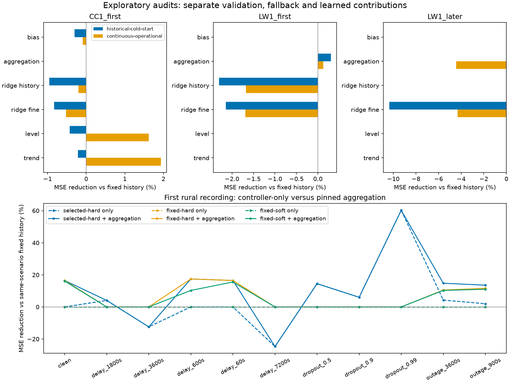
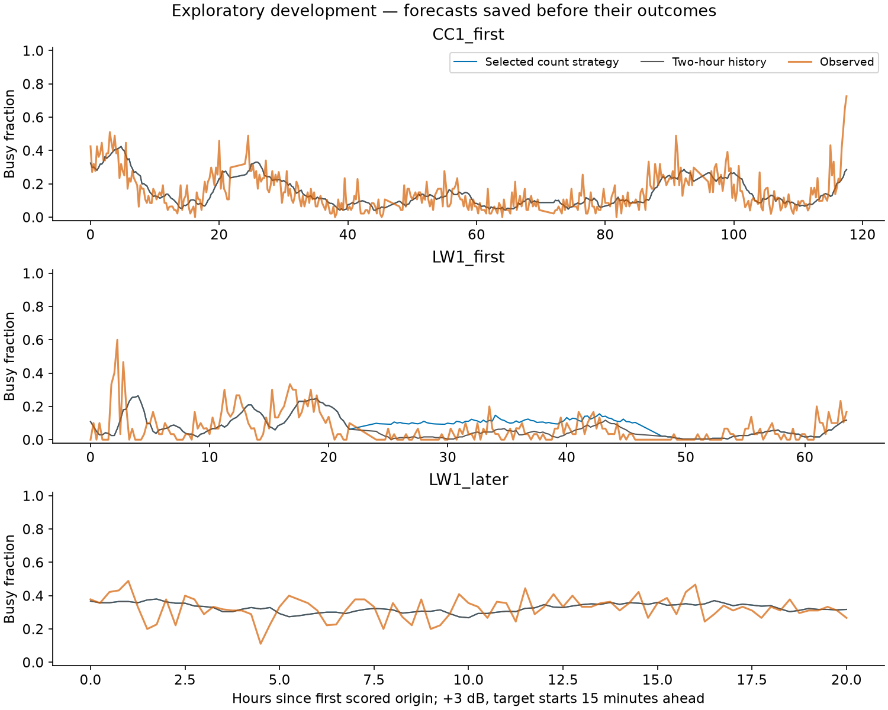
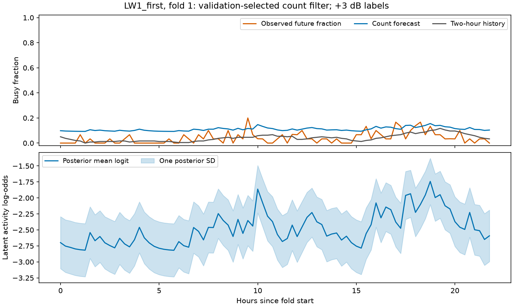
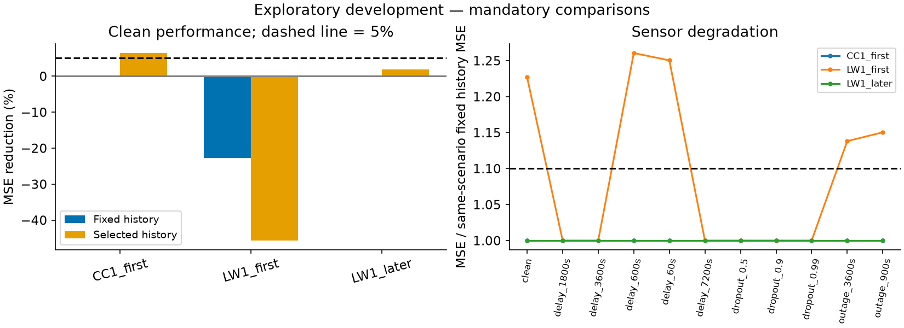
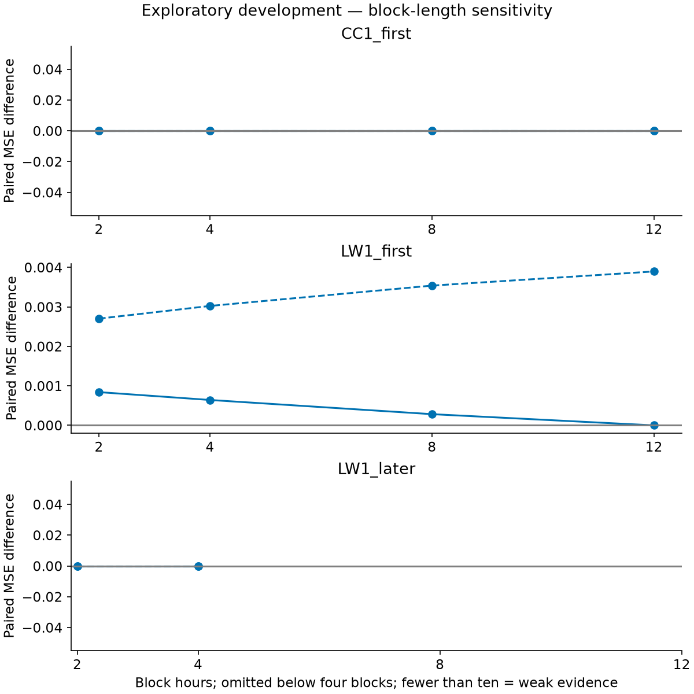

# Can earlier measurements make learning more reliable?

**The framework is stronger; the new learned method did not earn promotion.** This study
separates validation, controller behavior and learning, and records the complete declared
search. Two-hour history remains the default recommendation.

The task is unchanged: at noon, predict the busy fraction during **12:15–12:30** at 2437 MHz.
“Busy” means a received-power snapshot exceeds the frozen first-day noise floor by 3 dB.
It does not identify a transmitter or measure decoded traffic. The [data study](data_study.md)
explains the measurements. All three recordings have already been inspected and are
exploratory development data.

## First make validation resemble operation

Earlier studies initialized learning independently before each six-hour validation block,
using a ten-hour fitting embargo. Operational forecasts instead kept updating their local
state as completed measurements arrived. We compared both protocols using immutable saved
candidate forecasts, identical validation windows and identical scored origins.

The new continuous protocol initializes once after the first day. Its validation forecasts
use the states available at those times, including causally delivered updates. **Validation
still ends ten hours before outer-fold selection.** This replaces per-block initialization;
it does not rewrite the historical experiment or allow future outcomes into a prediction.
Selection still requires at least 2% pooled improvement against both history references
and improvement against both in each validation block.

Continuous validation changed some selections and improved the urban residual strategies,
but did not produce consistent gains across the recordings. For example, continuous
aggregation selected a strategy whose later rural-session MSE was about 4.46% above fixed
history; historical validation selected history there. We adopted continuous validation
because it matches deployment, rather than choosing the protocol with the best scores.

*Top: selected strategies evaluated on the same 439 urban, 239 first rural and 81 later
rural origins. Bottom: a fixed aggregation candidate under three controller rules. Positive
values mean lower MSE than same-scenario two-hour history. These are retrospective development
comparisons, not fresh confirmation.*

## Separate the controller from learning

We replayed one previously identified aggregation candidate without retuning: a six-hour
half-life, learning rate 0.5 and correction strength 1. We also replayed each controller
without correction. The three controller rules used selected-history fallback, fixed-history
fallback, or fixed fallback plus a quality-dependent shrinkage of permitted corrections.

Clean-input fallback was never needed on scored origins. The pinned aggregation candidate
reduced MSE by 6.95% urban and 16.48% first rural against fixed history, but increased it by
10.61% on later rural data. Its first rural gain against independently selected history was
only 0.82%. It therefore remains an unsuccessful retrospective candidate. Soft shrinkage
did not solve that inconsistency. Under stale or sparse inputs, fallback choice can change
loss even when learning is disabled; the tables keep those effects separate.

## Learn from five-minute activity counts

The new model receives non-overlapping five-minute bins containing the number of busy and
total delivered snapshots. A bin becomes available only after it finishes, plus any
simulated delay. At least 80% of expected observations are required; an inadequate bin
provides no idle label. Each recording resets at its start, and its first 24 hours establish
calibration and initialization.
Completion times use the retained cache convention of snapshot timestamp plus 0.001 seconds,
matching existing predictors. That is an availability convention, not an estimated sweep duration.

A latent probability evolves toward its first-day level, with uncertainty. Binomial and
beta-binomial observation models distinguish sampling variation from additional dispersion.
The declared grid has **24 learned configurations and one history-only candidate**: three
persistence half-lives, two state standard deviations, two dispersions and two blend strengths.
Strength variants share a filter. No settings were added after results.

Forecasts average the expected activity in the three future five-minute bins. They use
nominal exposure, not future observed counts. The existing age, coverage and delivered-feedback
safety conditions remain mandatory; failed gates return fixed two-hour history exactly.
This probabilistic blend is a different model and does not use the earlier residual cap.

Before real execution, the 801-node numerical grid differed from 1,601 nodes by as much as
0.00319 in the synthetic suite. We therefore used **1,601 nodes globally**, verified against
3,201 nodes: the maximum difference was 0.000799, below the declared 0.001 tolerance.
This precision change preceded real results and did not change the scientific parameter grid.

*Predictions were issued before their outcomes. Orange is the unchanged fifteen-minute
scoring label; blue is the selected count strategy, including exact history fallback.
The urban and later rural curves coincide with history because validation selected it.*

## What happened?

| Recording | Scored origins / folds | MSE reduction vs fixed history | vs selected history |
|---|---:|---:|---:|
| Urban first session, CC1 | 439 / 5 | 0.00% | 6.42% |
| Rural first session, LW1 | 239 / 3 | −22.68% | −45.68% |
| Later rural session, LW1 | 81 / 1 | 0.00% | 1.82% |

Negative values mean higher error. The positive urban/later numbers against selected history
are **history-reference differences**, not learned gains. Selection retained history on
eight of nine folds. On one first-rural fold, a half-hour, standard-deviation-0.5 binomial
model with full blend passed earlier validation, then performed poorly during evaluation.
Later LW1 inherited the final first-session selection and was never tuned on its outcomes.

*The count forecast often exceeded the observed future fraction in this fold. Below, the
latent log-odds state follows completed measurements. Shading is one posterior standard
deviation of that model state; it is not a calibrated forecast interval.*

*All declared degradation scenarios were evaluated. Stochastic scenarios use five paired
masks, averaging losses rather than predictions. The dashed lines mark the 5% clean-gain
and 1.10 degraded-MSE-ratio criteria; both history references remain mandatory.*

No model numerical failures occurred. The study retained every candidate, validation score,
selection and scored origin. One execution was interrupted to eliminate unused projections
when correction was disabled; it remains in the registry. The restarted implementation
preserved all 18,942 saved urban candidate forecasts exactly. No model search was expanded.

The [machine-readable advancement decision](../results/operational_learning/run/advancement.json)
is **not qualified**. Matching fixed history is not a 5% improvement. The rural losses also
fail the clean and robustness requirements. A validation rule can prevent many harmful
choices without guaranteeing that every selected model will generalize to its next fold.

## Evidence and experiment history

The [append-only registry](../results/experiment_registry.jsonl) records declarations before
real execution, source/input/origin fingerprints, candidate outcomes, interruptions and review.
Its [generated history and comparisons](../results/operational_learning/registry/) retain
unsuccessful attempts. Imported historical rows keep original source references and explicitly
flag missing metadata; they are not new independent experiments.

Scientific identity depends on resolved settings and executable scientific code, not output
names. Documentation and plot edits do not create a new attempt. Duplicate execution requires
an explicit reproduction and agreement check; parameter revisions need a parent and motivating
evidence. Registry locks, durable appends and explicit recovery keep interrupted work visible.

The [saved evidence](../results/operational_learning/) includes predictions, validation records,
bin availability, delivered feedback, posterior summaries, numerical checks and original
fitting manifests. Posterior arrays and detailed interrupted outputs remain locally archived.
Reporting changes have separate provenance and do not replace historical fitting fingerprints.
See [reproduction commands](reproduction.md#operational-learning-declared-in-the-registry).

*Paired 95% MSE-difference limits use 2/4/8/12-hour blocks without crossing recording or fold
boundaries. Eight hours is the main analysis. Intervals below four blocks are omitted;
fewer than ten blocks is weak evidence. A flat zero interval reflects identical history
forecasts, not proof that learning improves prediction.*

Short, repeatedly reused recordings limit the evidence. Neither these intervals nor
chronological validation accounts for the complete history of exploratory search. CC2 and
the canonical confirmation protocol remain unchanged and uninspected. Duration models,
spectral extensions or further tuning require separately declared follow-up work.
