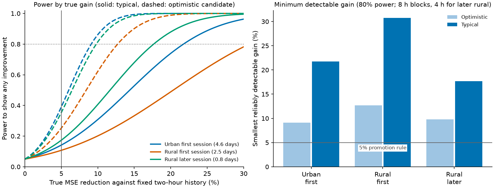

# Would these recordings have detected a small learned gain?

**No.** A model that truly cut error by 5% would almost never have been confirmed on all three
recordings. The saved forecasts can rule out *large* improvements over two-hour history, but
not small ones, so the earlier negative results say less about small gains than they appear to.

In everyday terms: if you flip a coin 20 times you cannot tell a fair coin from a slightly
loaded one. Twelve days of radio recordings are similar. This page measures how big a
difference these recordings could have revealed.

This analysis reads only the saved operational-study forecasts. It fits no model, opens no
new recording and adds no candidate to the experiment registry; CC2 is untouched.

## The question

The promotion rule asks for at least a 5% reduction in mean squared error (MSE) against
fixed two-hour history on every recording. Statistical power is the chance that a comparison
detects a gain that is really there. We estimate it from how noisy the paired differences in
squared error are, using the 8-hour block bootstrap of the operational study (4-hour blocks
for the later rural session, which has too few 8-hour blocks).

The noise depends on how far a candidate moves away from history, so we report the spread
across **31 candidate forecasts: 24 count-model settings and 7 history variants** (every
non-baseline candidate in the saved operational study that differs from fixed history):
**optimistic** (10th percentile standard error, candidates that stay near history),
**typical** (median) and **aggressive** (90th percentile).

## Results

*What to notice: the curves climb slowly, so only large true gains are detected reliably.
Left: probability that a one-sided 95% bound shows any improvement, by true MSE reduction.
Right: the smallest true gain detected with 80% power. Reference lines mark the 5% rule and
80% power.*

| Recording | Windows (days) | Blocks | Top-decile share of error | Effective windows | Smallest detectable gain: optimistic / typical | Days needed for a true 5%: optimistic / typical |
|---|---:|---:|---:|---:|---:|---:|
| Urban first (CC1) | 439 (4.6) | 13.7 | 58% | 62 | 9.1% / 21.7% | 15 / 86 |
| Rural first (LW1) | 239 (2.5) | 7.5 | 71% | 22 | 12.7% / 30.8% | 16 / 94 |
| Rural later (LW1) | 81 (0.8) | 5.1 | 45% | 25 | 9.8% / 17.7% | 3 / 11 |

Effective windows is (Σe²)² / Σe⁴ for squared errors e², the sample size left after a few large
errors dominate. The rural-later row rests on five blocks and is rough. Against
independently selected history the detectable gains are similar (typical 17–21%).

**If a model truly cut MSE by 5%, the chance of showing it on all three recordings was 3.5%
(optimistic) or 0.3% (typical).** At a true 10% gain it was 44% or 2.5%; at 20%, 99% or 32%.
A model with a true gain of 30% would typically have been seen on each recording
(typical power 96%, 78% and 99.5%).

Two further findings sharpen this:

- **Most error sits in a few windows.** The worst tenth of windows carry 45–71% of squared
  error, and effective sample sizes are 22–62 rather than 81–439.
- **Hindsight winners did not carry over.** Among the 31 unselected candidates, ten beat fixed
  history on the first rural session at the 95% level (median gain 11.5%), yet none was
  better on the later rural session; all 31 were worse. Gains visible only afterwards are
  what the noise levels above predict, and selection did not find them in advance.

For orientation, fixed-history MSE is 2.5 times (urban) and 3.8 times (rural first) the
error expected if snapshots were independent coin flips at the forecast rate, but equals it
on the later rural session (1.0). That is a rough sampling-noise heuristic, not a bound on
what any forecaster can achieve. It does suggest that forecastable variation exists in the
first sessions and little remains in the later one.

## Sensitivity: count models only

Seven of the 31 candidates are plain history variants rather than learned models. Restricting
the noise estimate to the 24 count-model settings (rerun with `--candidates count`, saved under
[`results/power_analysis/count_models_only/`](../results/power_analysis/count_models_only/))
leaves every conclusion unchanged:

| Recording | Smallest detectable gain, typical: 31 candidates | 24 count models |
|---|---:|---:|
| Urban first (CC1) | 21.7% | 21.8% |
| Rural first (LW1) | 30.8% | 34.3% |
| Rural later (LW1) | 17.7% | 16.3% |

At a true 5% gain, the chance of showing it on all three recordings is 4.2% (optimistic) or
0.3% (typical). Eight of the 24 count models beat fixed history on the first rural session at
the 95% level, and none was better on the later rural session.

## What this means

1. **The evidence rules out large gains, not 5–10% gains.** This changes how the earlier
   negative results should be read.
2. **A 5% claim needs about 90 days of independent test windows** at typical noise, or about
   15 if candidates stay close to history. Ten sites with nine days each would reach the
   typical figure, assuming sites are exchangeable and standard errors shrink with the square
   root of sample size.
3. **Judge a pooled result.** A single pre-declared test across many sites is far more
   powerful than requiring 5% on every short recording.
4. **A loss less dominated by rare transitions** (absolute error, pinball loss) might need
   less data, because a few windows would no longer carry most of the error. This was not
   tested here.

## Limits

Noise comes from one family of candidates on the same recordings that were repeatedly
inspected. Bootstrap intervals from 5–14 blocks and a normal approximation for
heavy-tailed losses are rough, so treat the figures as orders of magnitude. Hindsight gains
use all scored origins without nested selection, and the days-needed scaling assumes
stationary noise.

Reproduce with `uv run python scripts/power_analysis.py`. Tables are in
[`results/power_analysis/`](../results/power_analysis/).
