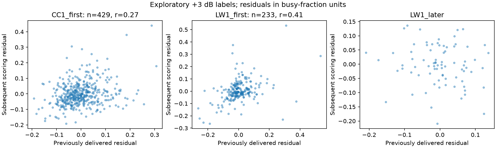
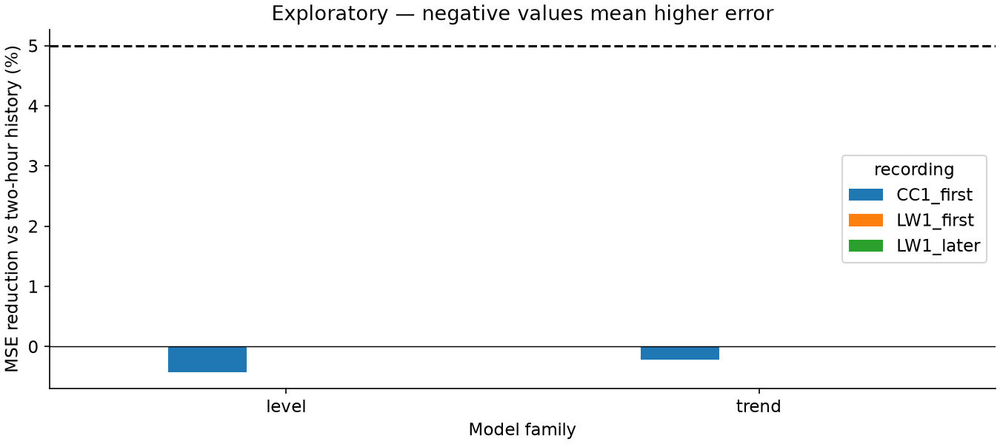
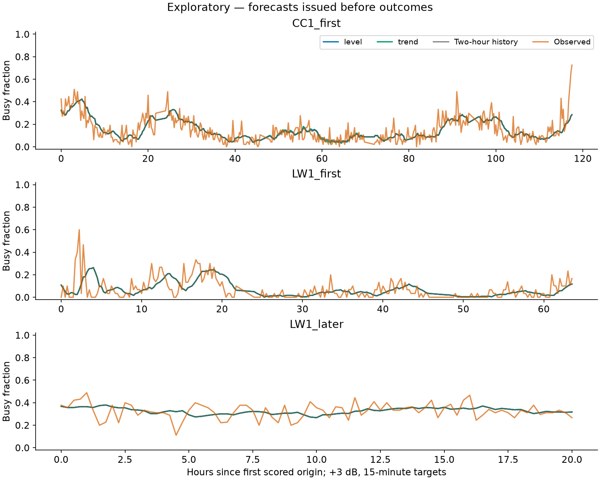
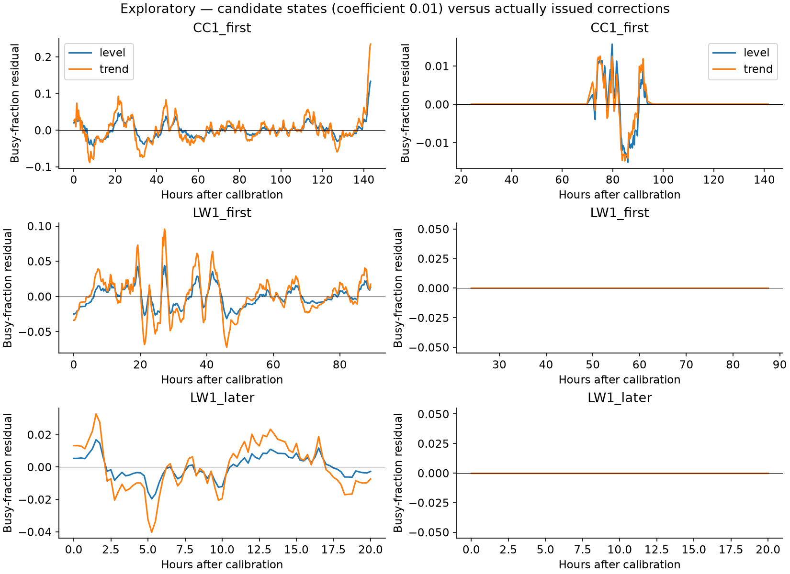
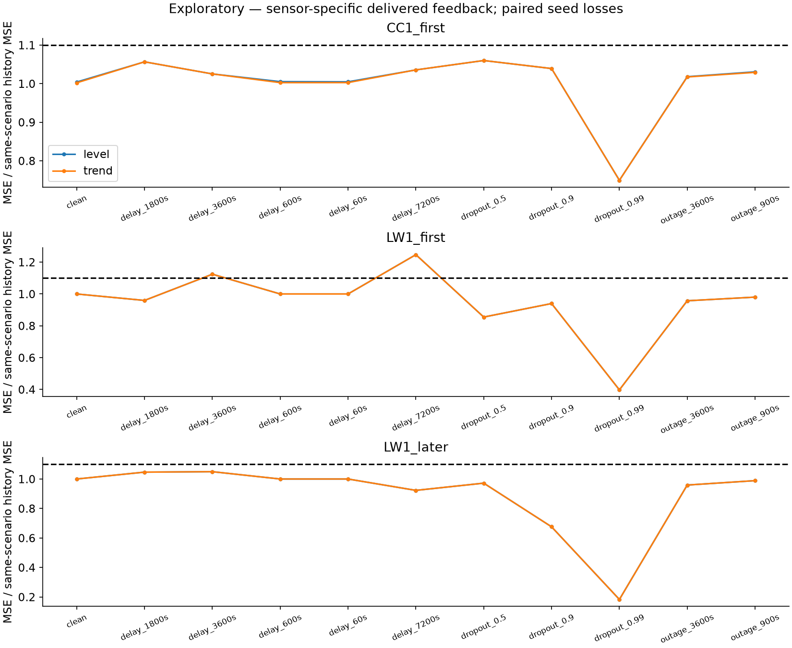
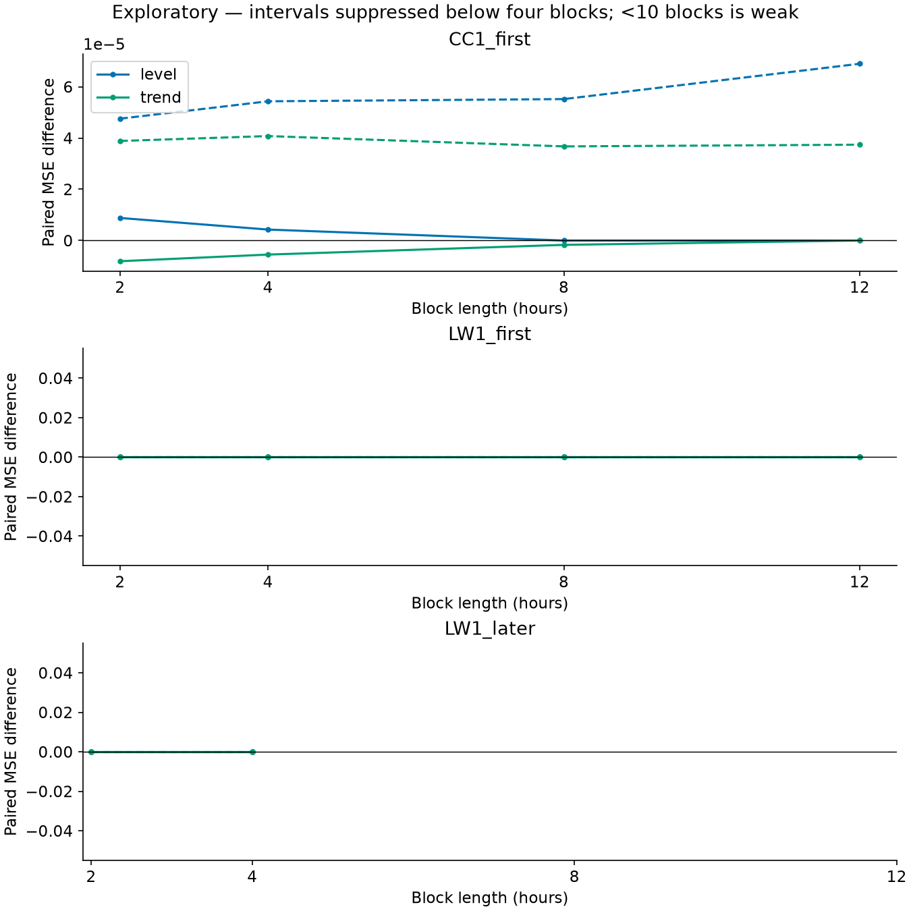

# Can predictable residuals become useful corrections?

**The diagnostic gate passed, but the targeted state-space study did not improve forecasting
reliably. Two-hour history remains the recommended default.** This is a completed follow-up on
three already-inspected recordings, not an independent superiority test.

The task is unchanged: at noon, predict the fraction of received-power snapshots above the
frozen first-day +3 dB threshold during 12:15–12:30, at 2437 MHz. The
[data study](data_study.md) explains what these labels measure.

## What justified another experiment?

The [prediction-only diagnosis](../results/residual_state_space/diagnosis/) reproduced all
1,160 earlier validation scores and selections. It compared every earlier candidate on identical
scored origins, rather than interpreting controller selections as learned successes.

Five aggregation candidates met the predeclared headroom gate across both first recordings.
For example, one identical six-hour, rate-0.5, full-strength candidate retrospectively reduced
MSE by 6.95% at urban CC1 and 16.48% at rural LW1 against two-hour history. Against independently
selected history, its gains were 12.92% and only 0.82%, respectively. This candidate was identified
after evaluation: these numbers are diagnostic opportunities, not performance of the deployed
selection procedure or evidence meeting the 5%-against-both promotion rule.

Residuals also persisted. Previously delivered errors correlated with subsequent two-hour
forecast errors at **0.27 across 429 pairs at CC1** and **0.41 across 233 pairs at first LW1**.
Pairs used only released feedback and stayed within contiguous scored segments and folds.
Later LW1 had 79 pairs, below the declared 80-pair minimum, so its correlation was unavailable
for this gate. Adjacent pairs are dependent; these correlations are descriptive, not significance tests.

*Clean inputs, +3 dB labels, 15-minute targets at 2437 MHz. Each point pairs a previously delivered
residual with a subsequent scoring residual, in busy-fraction units. Sites and pair denominators
are identified above; all observations follow first-day calibration.*

The remaining [diagnostic tables](../results/residual_state_space/diagnosis/) separate retrospective
global, recording and fold winners; selection losses; controller fallbacks; and correction
saturation. The fixed-history fallback alternative and unclipped-correction comparisons change
saved predictions only. They do not change model state or justify claiming an improved method.
“Correction active” denotes an open safety gate; a selected history-only controller still applies
zero learned correction. Disabled corrections are not reconstructed from unavailable old raw values.

## What was tested?

The [declared configuration](../configs/residual_state_space.yaml) contains two small Kalman-filter
models: a local residual level and a level with a slope damped over a fixed two-hour half-life.
Each uses three noise coefficients and three correction strengths: **18 learned configurations,
plus the existing history-only controller**. No new feature family or selection search was added.

Feedback is the completed busy fraction minus the two-hour forecast actually issued for that
target. The filter tracks target completion time; delivery determines when it can assimilate
the observation. Forecasting projects the state forward without mutating it. Each replay fixes
its observation variance from initialization residuals and resets independently at recording gaps.

Corrections remain capped at ±0.1 before strength scaling. The original observation-age,
coverage and feedback-freshness controller remains unchanged. Poor evidence returns selected
same-scenario history exactly. Earlier validation retains two six-hour blocks, the ten-hour
embargo, the 2% pooled margin against both histories and improvement in each block. Later LW1
inherits settings from the final earlier first-session LW1 selection and receives its own
causal feedback; its outcomes do not tune those settings.

## What happened?

Positive percentages mean relative MSE reductions, not percentage-point changes in activity.
Every method uses the same 439 urban, 239 first-rural and 81 later-rural scored origins.

| Strategy | Urban CC1 | Rural LW1 first | Rural LW1 later |
|---|---:|---:|---:|
| Local level, versus two-hour history | −0.42% | 0.00% | 0.00% |
| Damped trend, versus two-hour history | −0.22% | 0.00% | 0.00% |
| Local level, versus selected history | +6.02% | −18.75% | +1.82% |
| Damped trend, versus selected history | +6.22% | −18.75% | +1.82% |

Both families selected learning in only one of five urban folds. All rural folds selected the
history-only controller. Zero rural gain therefore means no issued learned correction, not that
a learned model reproduced history successfully. Improvement over a weaker reference alone
does not satisfy the declared objective.

*Clean, post-calibration evaluation at each recording; +3 dB labels and identical 15-minute
targets. The dashed line is the 5% promotion threshold; negative bars indicate higher MSE.*

*Observed busy fractions are subsequent scoring outcomes. Both learned-family strategies and
two-hour history use identical scored periods; time is elapsed hours from the first scored origin.*

*Clean inputs at all three recordings, after calibration. Left: the predeclared coefficient-0.01
candidate states, including unselected candidates. Right: corrections actually issued on scored
origins. Values are busy-fraction units. Candidate adaptation is not an evaluation gain.*

## Robustness, evidence and conclusion

Neither family passes promotion. Urban and later-rural robustness ratios remain below 1.10,
but first-session rural history fallback reaches approximately **1.25 times same-scenario
two-hour-history MSE** under degraded evidence. This controller limitation is separate from
the learned correction and remains visible in the result.

*Each recording uses its identical scored origins and intact scoring labels. Stochastic scenarios
average five paired mask losses; feedback comes only from delivered observations. Ratios compare
against same-scenario two-hour history. Both history-reference comparisons are in saved tables.*

*Paired MSE differences against two-hour history, clean inputs, 2,000 resamples at 2/4/8/12 hours.
Blocks never cross folds or gaps. At eight hours, CC1 has 15 blocks; first LW1 has eight, marked
weak evidence; later LW1 has three, so its interval is suppressed. Short-record limitations remain.*

[Saved evidence](../results/residual_state_space/run/) retains every candidate score, selection,
feedback/update record, filter state and failure record. No model failures occurred. The
[scientific audit](../results/residual_state_space/scientific_audit.json) independently reproduced
188,418 filter-state records and checked identical labels, exact fallback and correction bounds.
Original fitting manifests and source snapshots remain unchanged; the additional adaptation
figure has separate prediction-only reporting provenance.

The [new experiment ledger](../results/residual_state_space/experiment_ledger.csv) supplements
the [earlier development ledger](../results/adaptive_learning/experiment_ledger.csv).
The [reproduction guide](reproduction.md#residual-diagnosis-and-state-space-follow-up) provides
download-free diagnostics, synthetic rehearsal and report regeneration.

The investigation found retrospective structure but no reliable operational gain under the
declared rules. No selection thresholds, caps or safety rules were relaxed after these results.
This pass ends here. All three recordings remain exploratory reuse; CC2 and its canonical
protocols remain untouched. The findings support a careful forecasting investigation, not
an independently confirmed learned-model advantage.
