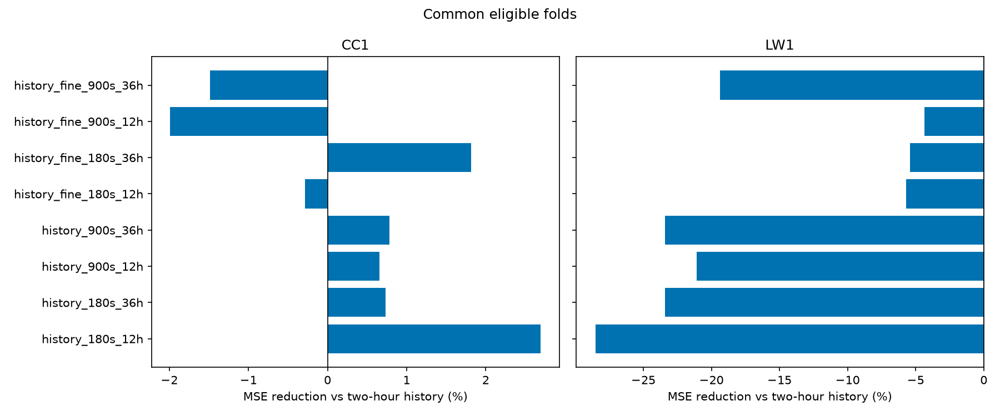
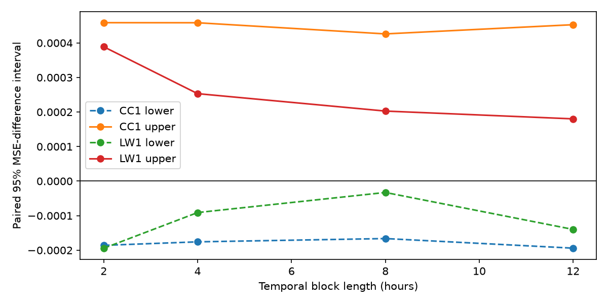
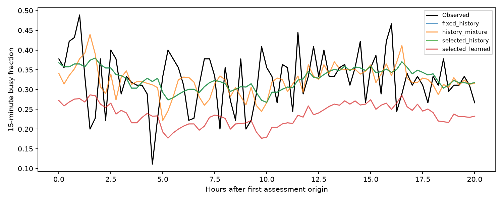

# Can finer measurements and shared training improve the forecasts?

This study tests two specific ideas on previously inspected recordings: use more spectral
detail, and share earlier training examples between the urban (CC1) and rural (LW1) sites.
The forecast still concerns the busy fraction of a 15-minute window starting 15 minutes ahead
at 2437 MHz. A busy snapshot exceeds the site's frozen first-day floor by 3 dB; it does not
measure decoded traffic or channel capacity.

**The declared development search did not improve on both history benchmarks at both sites.**
Its globally selected profile used fine power, 15-minute training spacing and 12-hour earlier
validation. On common eligible windows its error was **1.99% higher urban and 4.36% higher rural**
than fixed two-hour history. The comparison with independently selected history was a 6.94%
reduction urban and a 2.72% increase rural. The original study's advancement decisions stay unchanged.

## What did the development comparison show?

All eight profiles completed, with no candidate fitting failures. Common comparisons contain
351 urban origins across four daily folds and 151 rural origins across two folds. The first
fold at each site remains in all-fold outputs as an explicit insufficient-validation fallback.
Earlier selection does not guarantee lower error on the subsequent fold.



*CC1 is urban; LW1 is rural. Profile names encode inputs, training spacing in seconds and
validation hours. Positive values mean lower MSE; negative values mean higher MSE. These are
relative error changes on identical eligible windows, not percentage points of radio activity.*

The largest urban-only gain was 2.70% for history inputs, three-minute spacing and 12-hour
validation; that same profile increased rural error by 28.53%. Fine inputs reduced the rural
loss in several comparisons but never produced a joint advantage. The declared global rule
therefore selected the profile with the least unfavorable minimum node-wise skill.

| Method on the chosen profile's common clean windows | Urban MSE | Rural MSE |
|---|---:|---:|
| Fixed two-hour history | 0.005725 | 0.001939 |
| Independently selected history | 0.006274 | 0.001970 |
| Retained expanding mixture | 0.006162 | 0.001976 |
| Selected residual challenger | 0.005839 | 0.002024 |

MSE is squared busy-fraction error; lower is better. History selection uses the chosen
12-hour design, so its reference differs from the retained mixture study's 36-hour selected
history. The retained mixture predictions themselves are unchanged. Full results are in the
[profile table](../results/shared_learning/development/profile_summary.csv),
[common summary](../results/shared_learning/development/common_summary.csv) and
[daily table](../results/shared_learning/development/daily.csv).

The challenger also failed robustness: ten-minute delayed inputs produced 1.16 times fixed
history's MSE urban and 3.66 times rural. Under 99% dropout, exact two-hour fallback still had
2.00/1.96 times the independently selected same-scenario history's error. Returning history
prevents unsupported corrections; it cannot guarantee equality with a different history
reference. All scenarios and measured criteria remain in the
[advancement decision](../results/shared_learning/development/advancement.json).

Eight-hour paired exploratory skill intervals against fixed history span −8.74% to +2.80%
urban (12 blocks) and −15.63% to +1.58% rural (five blocks, weak evidence). Both include zero.
[All block sensitivities](../results/shared_learning/development/paired_reference_bootstrap.csv)
remain available; they do not correct adaptive reuse or establish superiority.



*Lower and upper paired 95% MSE-difference bounds, in squared busy-fraction units, against fixed
history on the same clean common windows. Negative differences favor the challenger. Nodes
and folds are never joined within a block. Block counts and weak-evidence flags accompany the CSV.*

## What happened on the reserved later session?

The profile, final models, fallback rules and reporting code were frozen locally before
post-calibration activity access. The one-shot assessment then scored 81 complete later-LW1
targets, containing 3,632 observations, across the remaining approximately 20.6 hours. Both
history references used the two-hour average selected before assessment. The learned model
was local residual boosting, depth 3, minimum leaf 20, strength 1; no parameters changed afterward.

| Frozen method | Later-session MSE | Change against fixed history |
|---|---:|---:|
| Fixed / selected two-hour history | 0.004884 | Reference |
| Retained mixture, refitted on first-session data only | 0.005988 | 22.60% higher |
| Residual challenger | 0.012721 | **160.45% higher** |



*LW1 after its own first-day calibration, +3 dB labels, identical complete 15-minute targets.
The horizontal axis shows forecast origins; observations concern windows starting 15 minutes
later. Fixed and selected history overlap. The challenger persistently underpredicts activity.*

Mean observed fraction was 32.49%, compared with 4.06% on the first-session common comparison;
these are descriptive, session-calibrated observations. The challenger averaged 23.69%, and
its correction averaged −9.06 percentage points. All 81 origins passed the fixed quality gate;
eight corrections reached the negative cap. This documents a failure to transfer the correction,
without identifying an emitter or establishing the cause of the distribution change.

Eight-hour uncertainty is **unavailable: three blocks**. Four-hour sensitivity has six blocks
and weak evidence; two-hour sensitivity has 11. The short assessment does not support broad
generalization. Its [saved summary](../results/shared_learning/later_assessment/common_summary.csv),
[block table](../results/shared_learning/later_assessment/paired_reference_bootstrap.csv) and
[one-shot lock](../results/shared_learning/audit/assessment_lock.json) retain the unfavorable outcome.
The completed assessment is now used data; further use must be disclosed as development.

## What changed, and what stayed fixed?

The fixed two-hour average is the main benchmark because it outperformed the retained history
mixture on the earlier common-window comparison. Independently selected history and that
mixture remain additional references. Original studies, labels and the CC2 protocol are unchanged.

Each challenger starts with the two-hour forecast, adds a learned residual clipped to
±0.1 and multiplied by a selected strength, then clips the prediction to [0, 1]. It returns
history exactly when the newest available observation is over 15 minutes old or the preceding
15-minute predictor window has fewer than half its expected observations. Missing observations
are missing evidence, never idle labels.

| Declared component | Candidates |
|---|---|
| Inputs | History; history plus fine power |
| Training spacing | 3 or 15 minutes |
| Earlier validation | 12 or 36 hours, in six-hour blocks |
| Residual ridge | Penalties 1, 10, 100, 1000; shared weights 0, 0.25, 0.5, 0.75, 1 |
| Residual boosting | Local or shared; depths 2/3; minimum leaves 20/40; 100 iterations, learning rate 0.03 |
| Correction strength | 0.25, 0.5, 1, plus one history-only candidate |

There are eight pipeline profiles, each with 85 learned/history-only candidates and eight
independently selected history references. Validation scores include clipping and fallback.
Exact ties prefer history-only, smaller strength, ridge, stronger ridge penalties, less sharing,
then shallower/larger-leaf boosting. The global profile maximizes the smaller node-wise skill
against fixed history, then the mean; declared simplicity preferences resolve remaining ties.
This global choice is exploratory adaptation to the development results.

History inputs include the eight recent/decayed forecasts, recent-fraction differences,
last state, observation age and normalized observation counts. Fine inputs add twenty
1 MHz linear-power means across 2427–2447 MHz, spectral 10th/50th/90th percentiles and their
spread. Each measurement is normalized against its own first-day fifth percentile and averaged
causally over 5, 15 and 30 minutes. Calendar, neighboring-channel and site-identity features
are excluded. Training alone determines median imputation, missingness indicators and scaling.

Shared models give each site equal total fitting weight. Every training target at both sites
must finish before the applicable cutoff. Daily evaluation and earlier validation retain the
ten-hour embargo; profiles are compared on identical common eligible folds and origins.
Insufficient-validation folds remain explicit two-hour-history fallbacks in the all-fold tables.
Five paired masks are used for stochastic dropout/outage scenarios, averaging losses rather
than forecasts. Degradation changes predictor evidence only.

## Data audit and limits

Raw archives are streamed without extracting recordings. First-session extraction reproduces
the retained labels and target counts exactly. Frequency axes and datatype agree across the
recording metadata; receiver hardware identifiers are unavailable, so absolute receiver
comparability is not established. Later LW1 samples about every 20 seconds, versus 30 seconds
in its first session. It uses its own first-day calibration and resets histories at the gap.

The error diagnosis groups losses by fold, past-observable history changes, age and availability.
Grouping by future activity is explicitly retrospective and never supplies predictor inputs.
Diagnostics motivate this declared search without enlarging its candidate grid.
On all 439 urban mixture origins, including the fallback fold, rising recent history had
MSE 0.00993 (123 origins), versus 0.00418 for small changes (192). All clean origins had recent,
well-covered evidence. This differs from the 351-origin common development population.
[Diagnosis tables](../results/shared_learning/audit/error_diagnosis.csv) retain rural and
future-outcome strata too; neither supplies a new predictor or a new search.

Meaningful exploratory improvement requires at least 5% lower MSE than **both** history
references at **each** site, at least two common folds per site, positive skill in at least
half the eligible folds, and degraded MSE no more than 1.10 times either same-scenario reference.
All failures and unfavorable folds must be reported. This is an advancement rule, not an
independent significance test. Temporal-block intervals do not account for repeated development.

## Reproduce and inspect

Run from the repository root in a fresh output directory:

```bash
uv sync --locked
uv run python scripts/run_shared_learning.py --mode synthetic-rehearsal --out-dir reproductions/shared_demo
```

Generated-data outputs are explicitly synthetic and provide no performance evidence. With
the already-held CC1/LW1 archives, prepare compact features and run the declared development:

```bash
uv run python scripts/extract_learning_features.py
uv run python scripts/run_shared_learning.py --mode audit --out-dir reproductions/shared_audit_new
uv run python scripts/run_shared_learning.py --mode exploratory --out-dir reproductions/shared_development_new
```

The cache is Git-ignored, resumable, checksum-verified and capped at 250 MiB. Extraction initially
reads only the first sessions and later LW1's first 24 hours. It performs no downloads.
`--cc1`, `--lw1`, `--config` and `--cache` override locations; CC2 inputs and overwrites are rejected.
Every run records source/configuration hashes, inputs, Git state, runtime versions and status.
Saved Parquet predictions support report regeneration without refitting.

The [public ledger](../results/shared_learning/experiment_ledger.csv) records all eight profiles,
workflow interruptions, the corrected reporting failure and the completed assessment. Earlier
unsuccessful searches remain in the separate [historical ledger](../results/followup_v2/history_mixture/experiment_ledger.csv).
Detailed unselected validation stays local. Public `run_manifest.json` files preserve original
fitting manifests; `manifest.json` verifies the published subset without rewriting fitting history.
The [freeze record](../results/shared_learning/audit/freeze_summary.json) identifies the private
package; it is not an independently timestamped protocol or a CC2 confirmation package.

The [publication audit](../results/shared_learning/audit/verification.json) records 158 passing
tests, passing lint, exact prediction-derived reports, 184 independent paired arithmetic checks,
review of all six published figures and unchanged hashes for 137 historical artifacts. Public
outputs occupy about 4.1 MiB; derived spectral caches remain local at about 14.1 MiB.

Regenerate the published development metrics without downloads or fitting:

```bash
uv run python scripts/run_shared_learning.py --mode report --source-run results/shared_learning/development --out-dir reproductions/shared_report_new
```

Later activity requires `--mode freeze` using a completed full local development run, followed
by `--mode assessment --freeze ...` in a fresh directory. A matching hashed code/configuration/
runtime package and an exclusive one-shot lock are checked before activity access. Final models
use first-session development data only; later first-day observations calibrate measurements and
supply history but cannot fit or tune the models. Remaining complete targets form one assessment
fold starting after calibration. This is a reserved later-session assessment from the same
campaign, with no independent registration or claim of broad generalization. CC2 remains
uninspected, and its separate independent-archive gate remains pending.
