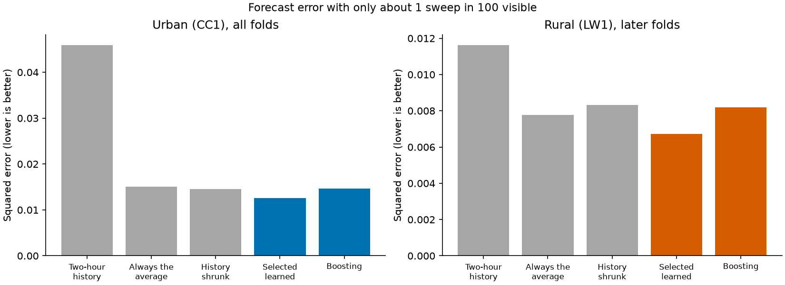
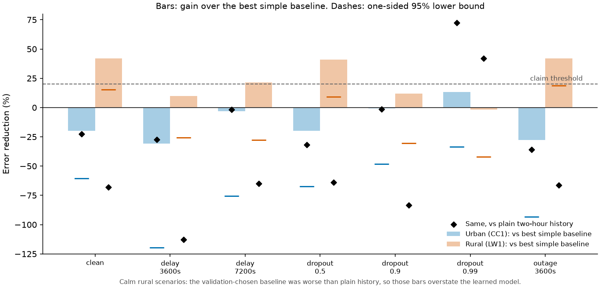
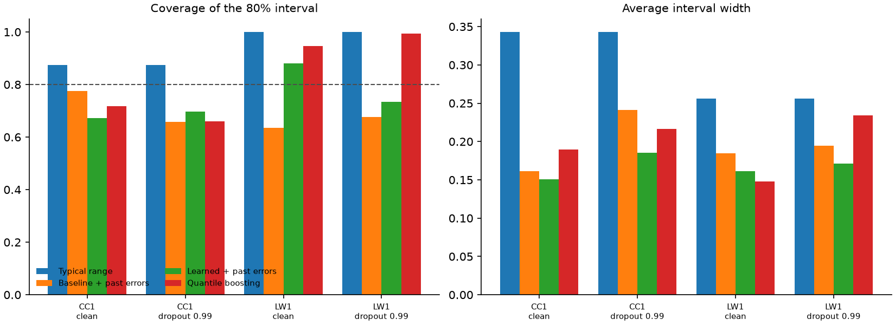

# When almost nothing is measured, do learned models help?

**Honest negative.** When about one measurement in a hundred is visible, learned models fixed the
problem that plain history has, but so did a trivial fix. A learned model trained and selected
for sparse input did not reliably beat the best simple baseline, and the large gains seen in
earlier exploratory results came from comparing against plain history.

The outcome label was computed by code from the rule written down before the run
([protocol](technical/sparse_regime_protocol.md)), not chosen afterwards. Terms are in the
[glossary](glossary.md).

## The question

Sometimes a monitor misses most of what is on the air: sensors drop out, links fail, data
arrive late. If you still have to forecast how busy a Wi-Fi channel will be, can a learned
model that has *practised on that same patchy view* do much better than the best simple rule?

Earlier studies fitted models on complete input and then tested them on patchy input, which is
like training a driver in daylight and testing at night. Here training, selection and testing all see
the same kind of patchy view. The patchiness is **simulated**: random sweeps are hidden from
the forecaster, while the answers (labels) always come from the complete recording.

## What happened at 99% dropout

| Squared error (lower is better) | Urban (CC1) |
|---|---:|
| Plain two-hour history | 0.0459 |
| Strongest simple baseline (history pulled toward the average) | 0.0146 |
| Selected learned model, matched training | 0.0126 |
| For reference: the clean-trained learned strategy from earlier work | 0.0374 |

*What to notice: plain history collapses when most data are missing, but simply pulling it
toward the long-run average removes most of the damage. The learned model is a little lower
at the urban site and no better at the rural site.*

Three things are true at once:

- **Learned models do far better than plain history.** At the urban site the matched learned
  model cut error by 72.5% against plain two-hour history. This is the "large gain" seen earlier.
- **Most of that gain is available for free.** Pulling history toward the average, with one
  weight chosen on earlier data, gets nearly all of it. Against that stronger baseline the
  learned model's gain is 13.3% at the urban site, and its one-sided 95% lower bound is
  −33.5%. The rural later folds show −1.6%, with a lower bound of −42.0%. Neither is
  distinguishable from zero, and the rule required a lower bound of at least 20%.
- **Training for the patchy view helps the learned model.** The clean-trained learned strategy
  scored 0.0374 at the urban site; matching training to the patchy input brought it to 0.0126.

## The rule, and why it said "negative"

A "large effect" needed five things to hold. Only one did:

| Requirement | Met? |
|---|---|
| Urban lower bound at least 20% | No |
| Rural later-folds lower bound at least 20% | No |
| Rural all folds at least half the threshold | Yes, but dominated by the first fold, which overlaps old channel selection |
| Absolute-error gain positive at both sites | No |
| No single block supplies over half the improvement | No |

A modest positive point estimate at the urban site and a near-zero one at the rural site, each
with wide uncertainty, is the signature of an effect that these recordings cannot confirm.

## Other scenarios (descriptive only)

*What to notice: urban bars are mostly negative, so learned models do not beat the strongest
simple baseline there. The rural bars look strong in calm scenarios, but the diamonds show why
not to trust them: against plain history the learned model is worse in those scenarios.*

In calm conditions (clean input, 50% dropout, a one-hour outage) the rural bars rise above the
threshold. This is a quirk of how the baseline was chosen, and the saved selection records show
the mechanism. In the second rural fold, the earlier data used for choosing contained a burst
of activity, so the selection decided history was useless and predicted the long-run average
(about 0.12). The fold itself was quiet, averaging about 0.04, so that choice was poor and
the "best simple baseline" ended up worse than plain history. Against plain history the
learned model loses in those scenarios, so these bars are not evidence for learned models. These
scenarios cannot change the label.

## Prediction ranges

Models were also asked for ranges, such as "90% likely to lie between 0.05 and 0.30".

*What to notice: a good 80% range captures about 80% of outcomes (the dashed line). The learned
and baseline ranges are narrower than the typical range but often capture too few outcomes.*

At 99% dropout the urban learned quantile range captured 65.9% of outcomes against a 80%
target, while the simple "typical range" captured more but was much wider. The ranges are
informative about uncertainty but not calibrated, and no method clearly won.

## What this means

- **Say this:** with very sparse input, plain history is a poor forecaster, and both a learned model
  and a one-line shrinkage fix it. The learned model's extra benefit was not shown.
- **Do not say this:** that learned models are better in sparse conditions. The comparison that
  would show it, against the strongest simple baseline, did not.
- **For practice:** if sensing is sparse, pull history toward the average first. That is cheap,
  needs no training, and captures most of what a learned model offered here.

## Scope and limits

Three recordings at two sites in February 2022; sparsity is simulated; the data were reused from
earlier exploratory work, and CC2, the one independent test, has not been run. The rural primary
cell has about five independent eight-hour blocks, so its intervals are wide. The rule was
amended once before any model was fitted, after its original power proxy triggered; the
[protocol](technical/sparse_regime_protocol.md#rule-amendment-disclosed) records both versions.
The first execution stopped on a file-naming bug and was re-declared in the registry; no setting
changed.

Numbers are checked by [`scripts/check_claims.py`](../scripts/check_claims.py). Tables, figures,
predictions and the registry attempt are in
[`results/sparse_regime/`](../results/sparse_regime/). Commands are in the
[reproduction guide](reproduction.md#sparse-regime-study).
