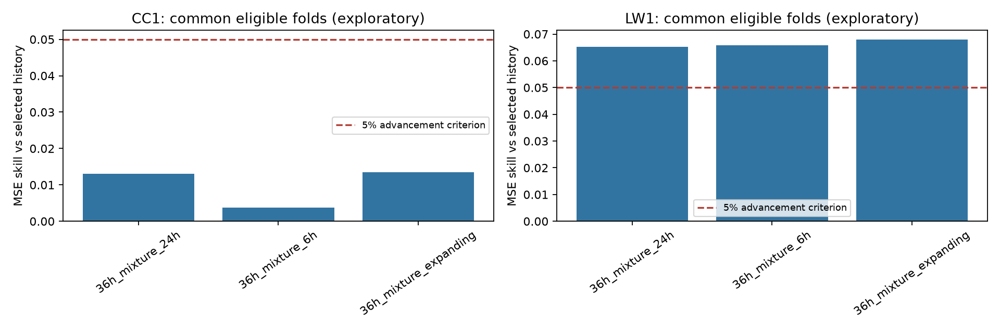

# Exploratory forecast development

This page records the earlier adaptive searches. The later declared
[shared-training/fine-input study](../shared_learning.md) also failed to advance and completed
an unfavorable reserved later-LW1 assessment. Its evidence is kept separately; the historical
mixture outputs and decisions below are unchanged.

**No method met the declared advancement rule.** The expanding history mixture is the best balanced challenger found during adaptive development on reused CC1/LW1 recordings. Its clean MSE reductions against independently selected history are **1.349% on CC1 and 6.804% on LW1**. These observations are not an independent superiority test. The canonical v2 confirmation design is retained; CC2 remains uninspected and confirmation pending.

## Retained method and comparison

The task predicts a 15-minute observed-sweep busy fraction starting 15 minutes ahead at 2437 MHz. Calibration uses the first 24 hours, labels use floor +3 dB, target coverage is at least 80%, and chronological fitting/validation retain the ten-hour embargo.

A convex mixture learns nonnegative weights summing to one over eight moving-average/decayed history forecasts. Its penalized training objective anchors weights toward the independently earlier-selected history. Earlier validation selects penalties {0, 0.001, 0.01, 0.1} and correction strengths {0.25, 0.5, 1}, with history-only first in exact ties. The difference from selected history is capped at +/-0.1 before applying strength and final [0,1] clipping. Correction requires observation age at most 15 minutes and at least 50% predictor coverage; otherwise it returns same-scenario history exactly.

The declared experiment compares expanding training with six-hour and 24-hour recency weighting, using 36 hours of earlier validation in six-hour blocks. **All three regimes and unsuccessful candidates remain in the retained outputs.** Expanding training was chosen retrospectively across development results, not prospectively confirmed.

| Training regime | CC1 clean MSE reduction | LW1 clean MSE reduction | Worst degraded MSE ratio |
|---|---:|---:|---:|
| Expanding | 1.349% | 6.804% | 1.000 |
| Six-hour recency | 0.376% | 6.579% | 1.000 |
| 24-hour recency | 1.310% | 6.529% | 1.000 |

Source: [common summary](../../results/followup_v2/history_mixture/common_summary.csv) and [advancement criteria](../../results/followup_v2/history_mixture/advancement_criteria.csv). The comparison uses 351 identical CC1 origins across four eligible folds and 151 LW1 origins across two. First-fold insufficient-validation outcomes remain in all-fold tables but are excluded from this common-fold comparison. The fixed two-hour history and canonical v2 learned strategy are additional references at the same origins.

Every dropout, outage and delay comparison uses history under the same degradation, with paired mask losses averaged before comparison. All mixture regimes pass the maximum 1.10 degraded-MSE ratio rule. Expanding training improves three of four eligible CC1 folds and both LW1 folds, but its CC1 improvement is below the unchanged 5% requirement on each node; **no strategy advances**.

## Evidence and error diagnosis

For expanding training, the eight-hour exploratory 95% skill interval is -0.108% to +2.904% on CC1 (12 blocks), and +4.017% to +10.696% on LW1 (five blocks, weak evidence). The two-hour LW1 sensitivity includes zero. Intervals do not adjust for repeated development and do not overcome the short-record limitation. [Block sensitivities](../../results/followup_v2/history_mixture/common_bootstrap.csv), daily results, dependence diagnostics, earlier-calibrated event thresholds and descriptive oracle outputs are retained.

Retrospective diagnosis found that the worst 10% of CC1 origins contribute 64.26% of squared loss, and 42 future rises contribute 55.57%. All clean common origins pass the quality gate, none hits the correction cap, and global squared bias contributes only 0.027% of CC1 MSE. These observations motivate caution about rare changes and distribution shift; outcome-defined strata are not deployable features. Diagnostic probes did not produce a joint improvement and were not promoted.

## Experiment ledger and unsuccessful outcomes

The [machine-readable ledger](../../results/followup_v2/history_mixture/experiment_ledger.csv) records all completed real-data development strategies, invalid runs, failed/repeated rehearsals and diagnostic probes. Skills are fractions (multiply by 100 for percent). Each strategy lists its comparison population, node-wise clean skill, worst same-scenario degraded ratio, decision, configuration hash and source fingerprint. Missing robustness values mean not assessed, not passed.

Development covered bounded residual ridge, trend corrections, power additions, sequence/burst models, static and contextual history mixtures, validation duration, expert calibration, neighbouring-channel/calendar features, and transition probability/magnitude models. None met advancement. The latest transition models worsened clean MSE on both nodes and reached approximately 3.45/3.49 times history MSE in the worst delayed-input scenario.

The original trend run had invalid recency weights and is explicitly excluded as performance evidence; corrected runs remain in the ledger. Power/context synthetic rehearsals also failed before corrected real-data evaluations. The replicated 36-hour mixture-selection control is not independent evidence. Detailed unsuccessful outputs and their original implementations are retained in a verified, Git-ignored local archive rather than duplicated in the public source tree. The compact ledger discloses the adaptive search; only the retained mixture and canonical studies are directly reproducible from the cleaned public code.

## Reproduction and provenance

The executable specification is `configs/history_mixture.yaml`. Use the [follow-up reproduction guide](followup_v2_reproduction.md) for fresh-output commands, synthetic rehearsal and prediction-only report regeneration. [Saved outputs](../../results/followup_v2/history_mixture) contain the original predictions, validation forecasts, selections, configuration and run manifest; their fitting fingerprints are unchanged. The cleanup audit is separate from original fitting provenance.

Original study and canonical v2 artifacts remain unchanged. Shared chronological/fallback/reporting helpers were extracted without changing synthetic selections, validation predictions, evaluation predictions or fitted mixture weights. Source cleanup changes the current code fingerprint: earlier local freeze packages do not certify this checkout. A fresh matching package would be required before any future independent archival; no package or CC2 run is created by this consolidation.

The [consolidation audit](../../results/followup_v2/history_mixture/cleanup_audit.json) records the current 141-test suite, exact synthetic equivalence, regenerated-table checks, verified archives and visual review. The original `audit.json` records checks at the time of the mixture run; it is retained as historical provenance.
